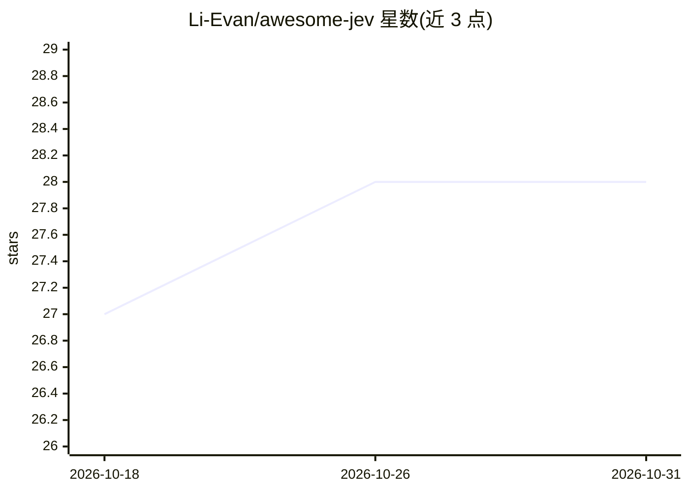

# Li-Evan/awesome-jev

⭐ 28 · HTML · CC0-1.0 · 推送 2026-09-29 · [GitHub](https://github.com/Li-Evan/awesome-jev) · [官网](https://li-evan.github.io/awesome-jev/) · 组织维护 · 中文 README

**Jev（TypeSafe System One）模型应用项目策展清单（3,398 条，16 类）**

社区维护的 Jev 项目画廊：Jev 是 TypeSafe 的 System One 模型，以校准概率回答类型化问题（Choice/Score/Noul 三个原语）而非生成文本，供代码做分支与路由。清单从 GitHub、X、Reddit、Hacker News、YouTube 与网络收录 3,398 个项目、demo 与文章，按金融交易、编码工具、浏览器与计算机使用、Agent 编排、游戏、机器人等 16 个场景组织，每条附原文链接与说明；另提供可搜索画廊、速查表与一本配套中文电子书。非 TypeSafe 官方维护。

## 筛选速览

| 维度 | 判定 | 备注 |
|---|---|---|
| AI 角色 | `ai-knowledge` | 知识聚合/清单类 |
| 许可风险 | `viral` | CC0-1.0 |
| 部署形态 | `library` | 以包/库形式分发 |
| 模型依赖 | — | README 未给出锁定关系 |
| 硬件要求 | — | 无带数字的原话,不猜 |
| 安装摩擦 | `low` | 无编译、无系统依赖或容器化 |
| 成熟度 | — | 结构信号不足 |

## 能力要点

- 收录 3,398 个项目/demo/文章，按 16 个场景分类组织
- 每条目附原始链接、热度与功能说明
- 提供 Jev Cheatsheet 速查表与配套免费中文书（17 章，EPUB/PDF）
- 中英双语并可在线搜索过滤画廊

## 适用场景

- 了解 Jev/TypeSafe 模型在各场景下的实际应用案例
- 按场景（金融、编码、机器人、游戏等）浏览社区项目
- 入门 Jev 时获取速查表与中文系统学习材料

## 场景标签

`精选清单` · 领域:学习与行业

## 证据(README 行号)

> L9: The most complete collection of what people build with Jev: **3,398 projects, demos, posts, and write-ups**, gathere
> L11: This list is community-maintained and not affiliated with TypeSafe. The official sites are `typesafe.ai` and `docs.

## 星数曲线

2026-10-18 27 → 2026-10-31 28（+1）

---
*卡片 v1 · prompt 1.4 · 生成 2026-10-26 · 置信度 mid · 依据 README sha `a1a48b0bd69b` · [字段定义](../../DATASET.md)*
