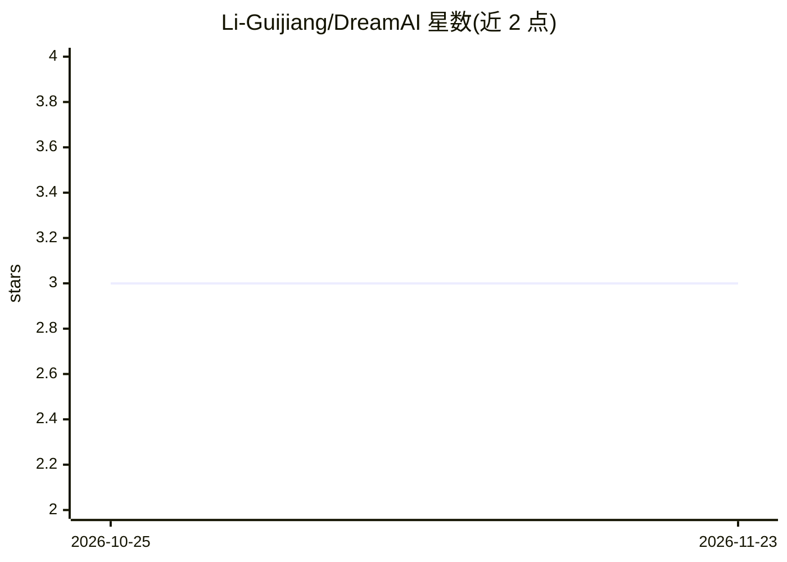

# Li-Guijiang/DreamAI

⭐ 3 · Python · MIT · 推送 2026-11-21 · [GitHub](https://github.com/Li-Guijiang/DreamAI) · [官网](https://github.com/Li-Guijiang) · 个人维护 · 中文 README

**通用 AI 助手 agent：提供 CLI/Web/桌面三种形态，支持多步规划与工具调用**

开源的通用 agent 项目，包含命令行包、Web 服务与 Windows 桌面应用三个独立版本号的交付物，提供 Chat/Work/Code 三种模式：Work 模式起草 3–6 步计划并逐步执行，Code 模式创建项目、写文件、装依赖并启动服务（命令需逐一确认）。核心通过 LLMProvider/Memory/Tool 三个接口解耦，后端可替换为任意 OpenAI 兼容端点或本地模型。当前处于早期开发状态（WIP），部分描述为规划中未实现。

## 筛选速览

| 维度 | 判定 | 备注 |
|---|---|---|
| AI 角色 | `ai-native` | 本体是模型或模型工具 |
| 许可风险 | `permissive` | MIT |
| 部署形态 | `self-host` | docker 或自建部署 |
| 模型依赖 | local-ok | 支持本地模型 |
| 硬件要求 | — | 无带数字的原话,不猜 |
| 安装摩擦 | `low` | 无编译、无系统依赖或容器化 |
| 成熟度 | `idea` | |

## 能力要点

- 三种形态：CLI（python -m dream_ai）、Web 服务、Windows 桌面应用，版本号各自独立
- 可替换后端：支持任意 OpenAI 兼容端点或本地开源模型，核心不绑定厂商
- think→act→observe→reflect 自主规划循环，带步骤预算、审批门与完整 trace
- 工具层含 JSON Schema 注册表、风险级别与确认门，文件工具限定沙箱目录

## 适用场景

- 从一句话开始完成写作、问答、翻译等多轮对话任务
- 让 agent 起草并执行多步骤研究与规划任务
- 在桌面端用 Code 模式从零搭建小项目（每条命令需批准）
- 本地管理个人档案与长期偏好，跨重启保留记忆

## 场景标签

`AI 助手` · 领域:对话与助手

## 证据(README 行号)

> L25: **Dream AI** is an open-source general-purpose agent built from scratch. It reasons, remembers, calls tools, and pl
> L82: |**Replaceable backend**|Any OpenAI-compatible endpoint (OpenAI, DeepSeek, Zhipu, Ollama, LM Studio); the core neve
> L89: |**Autonomous planning**|think → act → observe → reflect loop with a step budget, retries, approval before protecte

## 星数曲线

2026-10-25 3 → 2026-11-23 3（+0）

---
*卡片 v1 · prompt 1.4 · 生成 2026-11-22 · 置信度 mid · 依据 README sha `88d04ac84dce` · [字段定义](../../DATASET.md)*
