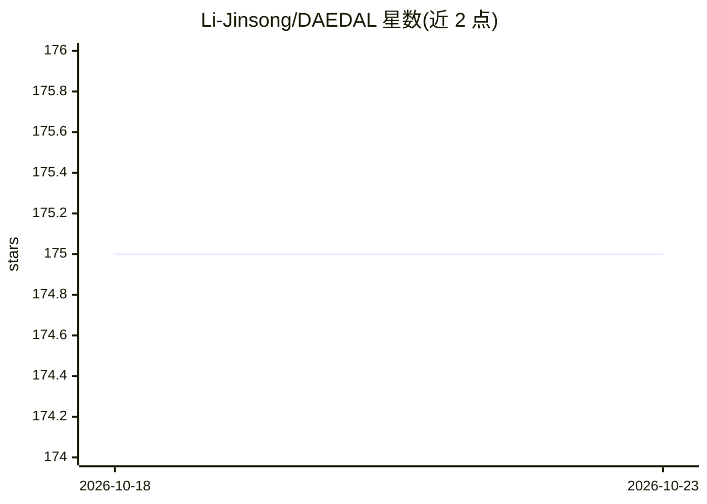

# Li-Jinsong/DAEDAL

⭐ 175 · Python · Apache-2.0 · 推送 2026-02-16 · [GitHub](https://github.com/Li-Jinsong/DAEDAL) · 组织维护

**扩散式大语言模型的无训练变长去噪推理策略（ICLR 2026 论文代码）**

ICLR 2026 论文 DAEDAL 的官方代码库：面向扩散式大语言模型（DLLM）需静态预设生成长度的限制，提出免训练的两阶段去噪策略。去噪前从短初始长度出发，依据序列末尾 EOS 置信度迭代扩展长度至任务适配规模；去噪过程中监测 [MASK] token 置信度，在不确定位置插入新 [MASK] 块实现动态扩展。实验覆盖 LLaDA-8B-Instruct 与 LLaDA-1.5，提供 conda 环境配置与评测脚本，基于 LLaDA 与 lm-evaluation-harness 构建。给扩散语言模型研究者使用。

## 筛选速览

| 维度 | 判定 | 备注 |
|---|---|---|
| AI 角色 | `ai-ecosystem` | LLM/agent 周边工具 |
| 许可风险 | `permissive` | Apache-2.0 |
| 部署形态 | `None` |  |
| 模型依赖 | — | README 未给出锁定关系 |
| 硬件要求 | — | 无带数字的原话,不猜 |
| 安装摩擦 | `low` | 无编译、无系统依赖或容器化 |
| 成熟度 | — | 结构信号不足 |

## 能力要点

- 两阶段变长去噪：初始长度调整 + 迭代 [MASK] 插入
- 免训练策略，无需修改模型权重
- 支持 LLaDA-8B-Instruct 与 LLaDA-1.5 评测
- 提供 DAEDAL 与固定长度 Baseline 的评测脚本

## 适用场景

- 运行 DLLM 变长生成实验复现论文结果
- 评测扩散语言模型在不同长度预算下的表现
- 研究基于模型内部信号的动态长度分配方法

## 场景标签

`模型评测` · 领域:评测与运维

## 证据(README 行号)

> L18:  💡 DAEDAL is a `training-free` denoising strategy that unlocks dynamic and variable-length generation for DLLMs, ac
> L26: > DAEDAL operates in two phases: 1) Before the denoising process, DAEDAL starts from a short initial length and ite
> L37: We introduce DAEDAL, a training-free, two-phase inference strategy designed to listen to these internal signals and

## 星数曲线

2026-10-18 175 → 2026-10-23 175（+0）

---
*卡片 v1 · prompt 1.4 · 生成 2026-10-22 · 置信度 high · 依据 README sha `336d29d87faa` · [字段定义](../../DATASET.md)*
