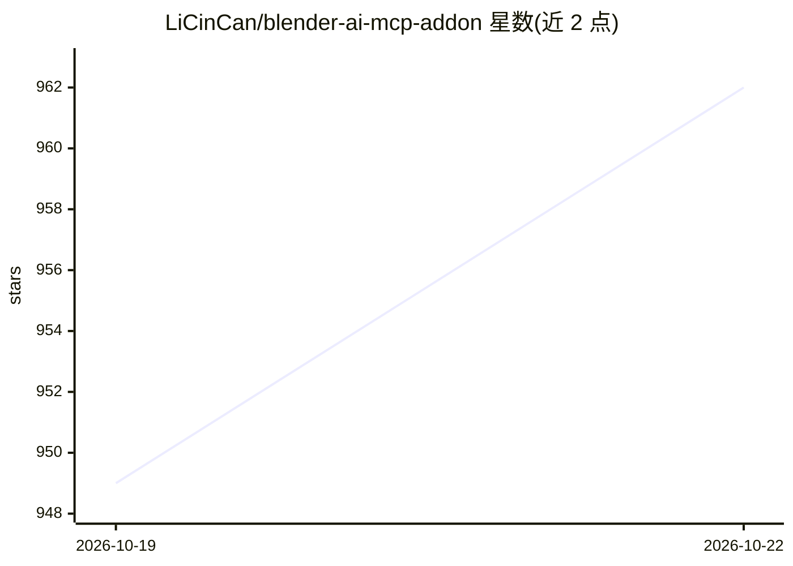

# LiCinCan/blender-ai-mcp-addon

⭐ 962 · Python · MIT · 推送 2026-10-20 · [GitHub](https://github.com/LiCinCan/blender-ai-mcp-addon) · 个人维护 · 中文 README

**面向 Blender 的 AI 助手插件：可视化聊天、场景工具与内置 MCP 服务器**

以 Blender 插件形式提供的 AI 助手：在 Blender 内或独立 Studio 窗口中对话，由助手检查场景、创建/编辑物体与材质、搜索并导入资产、导出场景，共 21 个场景工具；支持单助手或管理员/工人/审查者的多智能体链式工作流。可连接 OpenAI、Anthropic Claude、Google Gemini、OpenRouter、OpenCode Zen、Ollama 及自定义 API 端点，内置 MCP 服务器供外部 MCP 客户端接入。发布包面向 Windows x64 与 Blender 4.2+，通过 Blender 扩展安装 ZIP 文件使用。

## 筛选速览

| 维度 | 判定 | 备注 |
|---|---|---|
| AI 角色 | `ai-native` | 本体是模型或模型工具 |
| 许可风险 | `permissive` | MIT |
| 部署形态 | `desktop` | 安装包/桌面程序 |
| 模型依赖 | local-ok | 支持本地模型 |
| 硬件要求 | — | 无带数字的原话,不猜 |
| 安装摩擦 | `low` | 无编译、无系统依赖或容器化 |
| 成熟度 | — | 结构信号不足 |

## 能力要点

- 21 个场景工具：检查、创建、编辑、截图、资产搜索、场景导出
- 单助手或 Manager/Workers/Reviewers 多智能体团队链，带任务板
- 内置 MCP 服务器，支持 OpenCode 等客户端经认证 Streamable HTTP 接入
- 支持 OpenAI、Claude、Gemini、OpenRouter、Ollama 与自定义端点，可保存多套连接

## 适用场景

- 用对话让 AI 在 Blender 里搭建和编辑场景
- 自动执行重复性建模操作并逐步审批
- 让外部 MCP 客户端（如 OpenCode）控制 Blender 场景

## 场景标签

`AI 助手` `多智能体` · 领域:Agent 开发

## 证据(README 行号)

> L5: **An AI assistant for Blender that can inspect your scene, build objects, edit materials, find assets and carry out 
> L28: |**Your choice of AI**|Connect supported cloud providers, local Ollama models or compatible custom endpoints.|
> L49: Supported connections include **OpenAI, Anthropic Claude, Google Gemini, OpenRouter, OpenCode Zen, Ollama and custo

## 星数曲线

2026-10-19 949 → 2026-10-22 962（+13）

---
*卡片 v1 · prompt 1.4 · 生成 2026-10-21 · 置信度 high · 依据 README sha `a1ac47fa475b` · [字段定义](../../DATASET.md)*
