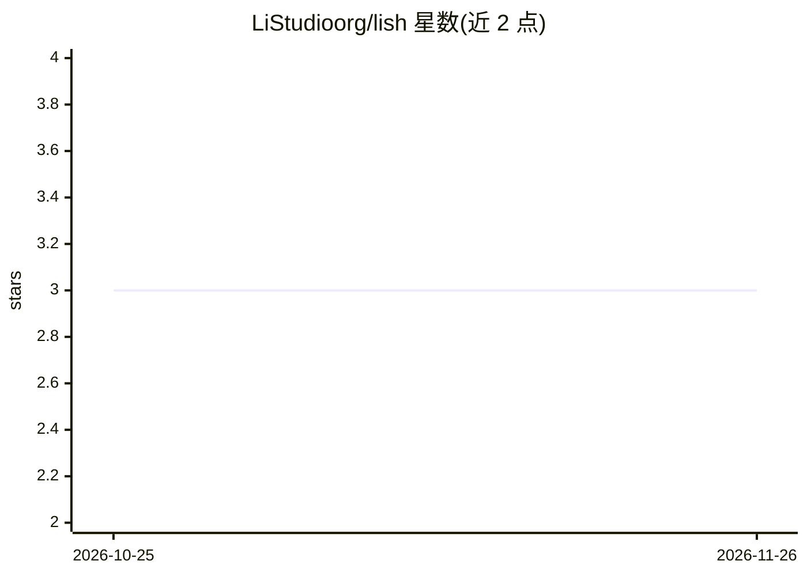

# LiStudioorg/lish

⭐ 3 · TypeScript · Apache-2.0 · 推送 2026-10-25 · [GitHub](https://github.com/LiStudioorg/lish) · 组织维护 · 中文 README

**给开发者的 TypeScript 微内核 Agent 应用基础设施层**

面向智能体应用的基础设施层，将会话状态、模型调用、工具执行、插件扩展拆为可组合的内核能力，其上提供 Web / TUI / CLI 三种前端形态。内核遵循微内核开闭原则：事件总线、依赖注入、LIFO 生命周期；会话以 append-only JSONL 日志为唯一真源；工具链可插拔，路径读写有双重校验沙箱，Shell 执行带超时；每个事件携带 traceId、耗时与 token 用量供事后回溯。通过 OpenAI 兼容接口接入模型渠道，支持子代理派生与插件热重载。

## 筛选速览

| 维度 | 判定 | 备注 |
|---|---|---|
| AI 角色 | `ai-ecosystem` | LLM/agent 周边工具 |
| 许可风险 | `permissive` | Apache-2.0 |
| 部署形态 | `library` | 以包/库形式分发 |
| 模型依赖 | local-ok | 支持本地模型 |
| 硬件要求 | — | 无带数字的原话,不猜 |
| 安装摩擦 | `low` | 无编译、无系统依赖或容器化 |
| 成熟度 | `idea` | |

## 能力要点

- 微内核架构：事件总线五种派发语义、依赖注入、插件热插拔
- 事件溯源会话：append-only JSONL 日志，重启后完整恢复
- 子代理派生（spawn_agent），复用父级工具权限并限制嵌套深度
- 全链路可观测：traceId、耗时、tokenUsage 轨迹面板

## 适用场景

- 基于工作区文件读写与 Shell 执行自建编码助手
- 用 spawn_agent 拆分并行子任务做多智能体编排
- 搭建每条事件可事后回溯的 Agent 平台
- 阅读内核源码学习 Agent 框架设计

## 场景标签

`Agent 框架` `多智能体` `LLM 可观测性` · 领域:Agent 开发

## 证据(README 行号)

> L17: `lish` 是一个面向智能体（Agent）应用的基础设施层。它把「会话状态、模型调用、工具执行、插件扩展」四件事拆解为可组合的内核能力，并在其上提供三种前端形态（Web / TUI / CLI）。
> L19: 设计上遵循**微内核的开闭原则**：内核只提供机制（事件总线、依赖注入、生命周期管理），所有业务策略都以插件或工具形式注册，因此新增能力无需改动核心循环。
> L25: |自建编码助手|基于工作区文件读写与 Shell 执行构建本地开发助手|

## 星数曲线

2026-10-25 3 → 2026-11-26 3（+0）

---
*卡片 v1 · prompt 1.4 · 生成 2026-11-22 · 置信度 high · 依据 README sha `901c31f4fa18` · [字段定义](../../DATASET.md)*
