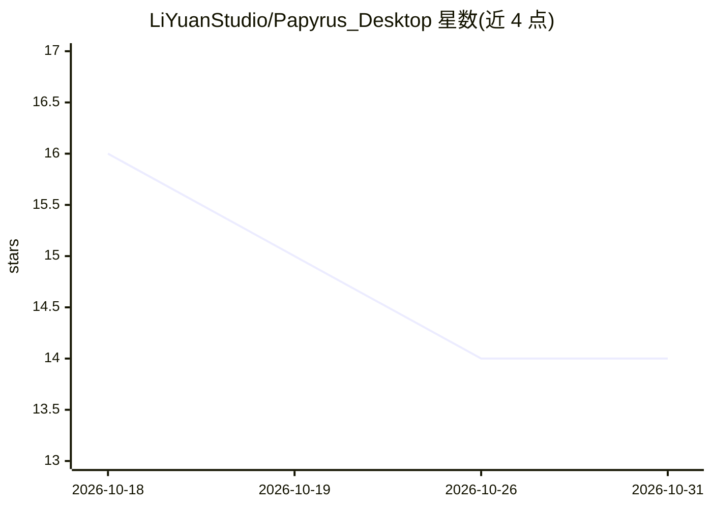

# LiYuanStudio/Papyrus_Desktop

⭐ 14 · TypeScript · MIT · 推送 2026-10-28 · [GitHub](https://github.com/LiYuanStudio/Papyrus_Desktop) · [官网](https://papyrus.liyuanstudio.com) · 个人维护 · 中文 README

**键盘驱动、带 AI Agent 的间隔重复记忆复习桌面应用**

Electron 桌面端（Fastify 后端 + React 19 前端）的间隔重复（SRS）复习引擎，内置 SM-2 调度算法，全键盘操作流模式；支持笔记管理与 Obsidian 导入、内容哈希的版本历史回滚。AI 部分：可接入 OpenAI/Anthropic/Ollama，Agent 模式下模型可调用增删卡片、搜索笔记等工具并带审批流程；API 密钥 AES-GCM 加密存储，数据本地优先。当前为 v2.0.0-beta.16，UI 与 API 可能变动。

## 筛选速览

| 维度 | 判定 | 备注 |
|---|---|---|
| AI 角色 | `ai-enhanced` | 去掉 AI 部分产品仍成立 |
| 许可风险 | `permissive` | MIT |
| 部署形态 | `desktop` | 安装包/桌面程序 |
| 模型依赖 | local-ok | 支持本地模型 |
| 硬件要求 | — | 无带数字的原话,不猜 |
| 安装摩擦 | `low` | 无编译、无系统依赖或容器化 |
| 成熟度 | `idea` | |

## 能力要点

- SM-2 间隔重复调度，全键盘流式操作
- AI Agent 可调用卡片/笔记工具，带手动或自动审批流程
- Obsidian vault 导入与关系图导航
- 笔记/卡片自动保存内容哈希版本，回滚生成前向版本

## 适用场景

- 高强度记忆训练与复习打卡
- 把 Obsidian 笔记导入并制成复习卡片
- 让 AI Agent 代为增删卡片、检索笔记

## 场景标签

`知识库管理` · 领域:知识与检索

## 证据(README 行号)

> L19: **Papyrus** is a minimalist, keyboard-driven, AI-agent-powered spaced-repetition (SRS) review engine, designed for 
> L27: - 🤖 **AI agent** — OpenAI / Anthropic / Ollama, with tool-call approval flow (manual or auto-approve) and call hist
> L128: - **Agent mode** — the model can invoke tools (add / edit / delete cards, search notes, …) under a tool-call appro

## 星数曲线

2026-10-18 16 → 2026-10-31 14（-2）

---
*卡片 v1 · prompt 1.4 · 生成 2026-10-31 · 置信度 high · 依据 README sha `c3243e48c3d3` · [字段定义](../../DATASET.md)*
