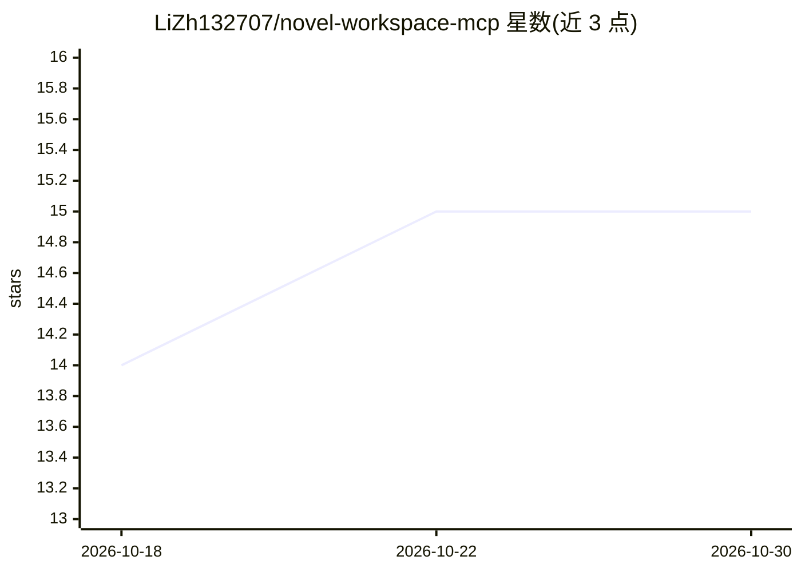

# LiZh132707/novel-workspace-mcp

⭐ 15 · Python · MIT · 推送 2026-10-01 · [GitHub](https://github.com/LiZh132707/novel-workspace-mcp) · 个人维护 · 中文 README

**面向长篇小说创作的本地 AI 写作工作台（Web + MCP + Skill）**

以单一项目状态管理长篇小说创作的本地工作区：内置世界构建、角色关系、章节管线（简报→计划→草稿→质量门→摘要→连续性交接）、伏笔规划器、手稿诊断、CRC 校验备份等，数据可审计。提供三种使用方式：浏览器 Web Studio、面向 LM Studio/Claude Desktop/Codex 等 MCP 客户端的 MCP 服务器、以及 Codex Skill。模型后端默认本地 LM Studio，也可接入任意 OpenAI 兼容 API；诊断与批量伏笔操作不调用模型。界面支持英/中/日三语。

## 筛选速览

| 维度 | 判定 | 备注 |
|---|---|---|
| AI 角色 | `ai-native` | 本体是模型或模型工具 |
| 许可风险 | `permissive` | MIT |
| 部署形态 | `self-host` | docker 或自建部署 |
| 模型依赖 | — | README 未给出锁定关系 |
| 硬件要求 | — | 无带数字的原话,不猜 |
| 安装摩擦 | `low` | 无编译、无系统依赖或容器化 |
| 成熟度 | — | 结构信号不足 |

## 能力要点

- Web Studio + MCP 服务器 + Codex Skill 三种使用方式
- 默认接入本地 LM Studio，或任意 OpenAI 兼容 API
- 章节管线与长篇连续性管理（事实、时间线、伏笔、因果检查）
- 伏笔规划器、手稿诊断、CRC 校验的项目备份均为无模型调用的确定性操作

## 适用场景

- 在本地规划并持续创作长篇小说，保持跨章节设定一致
- 让 Claude Desktop/Codex 等 MCP 客户端通过工具调用参与写作流程
- 导出诊断报告与伏笔清单审校稿件

## 场景标签

`AI 写作` · 领域:内容生成

## 证据(README 行号)

> L12: Novel Workspace MCP is a production-oriented AI writing workspace for long-form fiction. It keeps world-building, c
> L17: 2. **MCP server** — a tool surface for LM Studio, Claude Desktop, Codex, and other MCP clients.
> L22: Use a local LM Studio server by default, or connect to any OpenAI-compatible API. Set `NOVEL_LLM_PROVIDER=local` or

## 星数曲线

2026-10-18 14 → 2026-10-30 15（+1）

---
*卡片 v1 · prompt 1.4 · 生成 2026-10-30 · 置信度 mid · 依据 README sha `f111ae47ce7c` · [字段定义](../../DATASET.md)*
