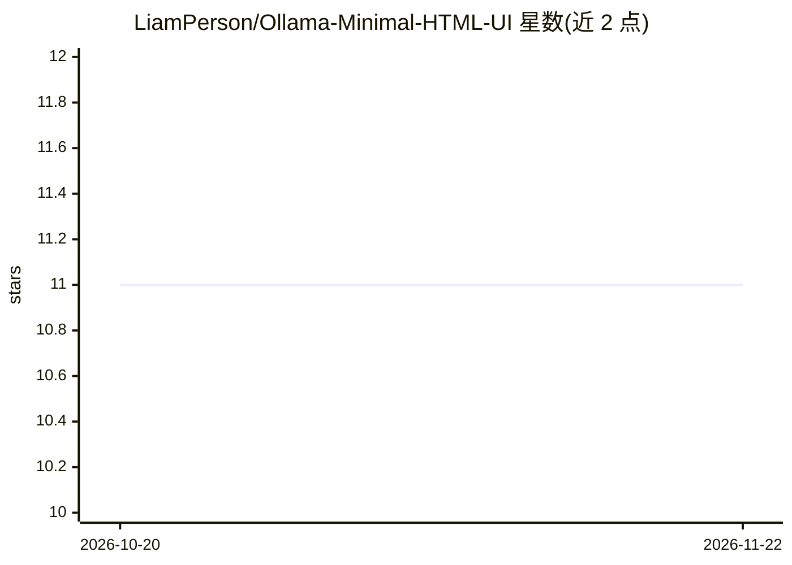

# LiamPerson/Ollama-Minimal-HTML-UI

⭐ 11 · JavaScript · GPL-3.0 · 推送 2025-12-28 · [GitHub](https://github.com/LiamPerson/Ollama-Minimal-HTML-UI) · 个人维护

**面向 Ollama 的极简纯 HTML/CSS 聊天界面**

用纯 HTML/CSS/JS 编写的 Ollama 对话客户端，代码压缩在极少文件中以便审计阅读，不使用 npm/pip 等依赖管理器，外部脚本本地存放于 /external/，无在线脚本加载。功能包括代码语法高亮、Markdown 渲染与净化、消息流实时显示、自定义 IP 地址与模型名、聊天历史记录。运行方式为直接打开或托管 index.html，无需编译。系统提示词可按 Ollama modelfile 加日期等动态信息，通过 window 变量可调整行为。

## 筛选速览

| 维度 | 判定 | 备注 |
|---|---|---|
| AI 角色 | `ai-ecosystem` | LLM/agent 周边工具 |
| 许可风险 | `viral` | GPL-3.0 |
| 部署形态 | `None` |  |
| 模型依赖 | local-ok | 支持本地模型 |
| 硬件要求 | — | 无带数字的原话,不猜 |
| 安装摩擦 | `low` | 无编译、无系统依赖或容器化 |
| 成熟度 | — | 结构信号不足 |

## 能力要点

- 纯 HTML/CSS/JS 实现，无依赖管理器，外部脚本本地存放
- 支持语法高亮、Markdown 净化渲染、消息流实时显示
- 可自定义 Ollama 服务 IP 地址与模型名称
- 浏览器控制台读取 chat_history，window 变量可配置

## 适用场景

- 想在浏览器里和本地 Ollama 模型对话
- 需要一个代码可读可审计的 Ollama 前端
- 不希望前端加载任何在线第三方脚本

## 场景标签

`聊天机器人` · 领域:对话与助手

## 证据(README 行号)

> L3: **_The simplest Ollama interface that actually works. Written in pure HTML/CSS for talking with Ollama._**
> L28: Run this program by opening or hosting `index.html`.
> L44: In `chat-history.js` and across `handle-model.js`, there is an initial message sent to the AI as the system prompt.

## 星数曲线

2026-10-20 11 → 2026-11-22 11（+0）

---
*卡片 v1 · prompt 1.4 · 生成 2026-11-19 · 置信度 high · 依据 README sha `97db037f07c6` · [字段定义](../../DATASET.md)*
