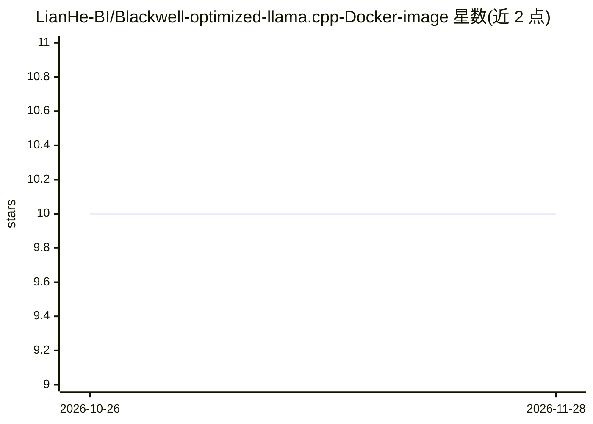

# LianHe-BI/Blackwell-optimized-llama.cpp-Docker-image

⭐ 10 · Jinja · Apache-2.0 · 推送 2026-08-06 · [GitHub](https://github.com/LianHe-BI/Blackwell-optimized-llama.cpp-Docker-image) · 个人维护 · 中文 README

**面向 RTX 50 系 GPU 的预编译 llama.cpp 推理 Docker 镜像**

将 llama.cpp（b9334，启用 sm_120 指令集与 NVFP4 编译）连同 CUDA 12.8 工具链打包为 Docker 镜像，免除手动编译与环境配置；内含 llama-chat 对话包装脚本、llama-server HTTP 服务与 llama-quantize 量化工具，可将 HuggingFace 模型转换为 GGUF。镜像从 Releases 分卷下载后 docker load 加载使用，仅用于推理。要求 NVIDIA 驱动 >=570，WSL2 未测试。

## 筛选速览

| 维度 | 判定 | 备注 |
|---|---|---|
| AI 角色 | `ai-ecosystem` | LLM/agent 周边工具 |
| 许可风险 | `permissive` | Apache-2.0 |
| 部署形态 | `self-host` | docker 或自建部署 |
| 模型依赖 | local-ok | 支持本地模型 |
| 硬件要求 | — | 无带数字的原话,不猜 |
| 安装摩擦 | `low` | 无编译、无系统依赖或容器化 |
| 成熟度 | — | 结构信号不足 |

## 能力要点

- 预编译 llama.cpp，启用 sm_120 与 NVFP4 编译选项
- 内置 llama-chat 包装脚本与 llama-server HTTP 服务
- 附带 HuggingFace 转 GGUF 与 Q4_K_M 量化工具
- Releases 提供分卷下载与 SHA256SUMS 校验

## 适用场景

- 在 RTX 50 系显卡上免编译运行 GGUF 模型对话
- 用 llama-server 在本地起 HTTP 推理服务
- 将 HuggingFace 模型转换为 GGUF 并做量化

## 场景标签

`推理引擎` `模型量化` · 领域:训练与推理

## 证据(README 行号)

> L7: A ready-to-run llama.cpp inference container for NVIDIA Blackwell GPUs (RTX 50 series). The image removes the need f
> L9: - Pre-compiled llama.cpp with sm_120 support (`-DCMAKE_CUDA_ARCHITECTURES=120`)
> L14: > This image is for inference only. Load the image, run the container, and use `llama-chat`.

## 星数曲线

2026-10-26 10 → 2026-11-28 10（+0）

---
*卡片 v1 · prompt 1.4 · 生成 2026-11-20 · 置信度 high · 依据 README sha `40ae921ed7a0` · [字段定义](../../DATASET.md)*
