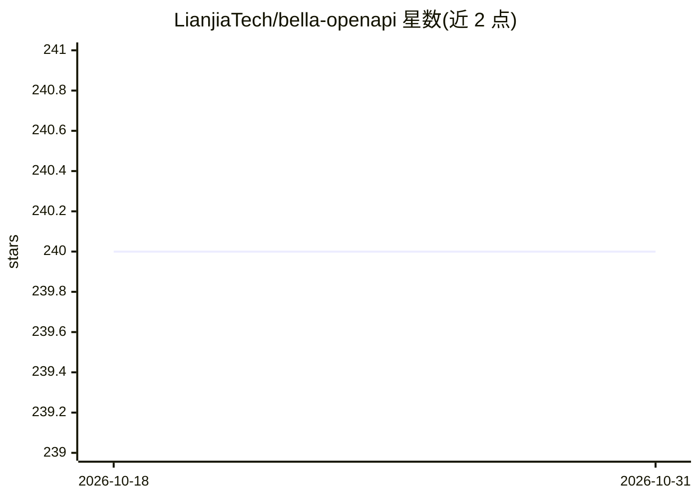

# LianjiaTech/bella-openapi

⭐ 240 · Java · MIT · 推送 2026-10-30 · [GitHub](https://github.com/LianjiaTech/bella-openapi) · [官网](https://api.bella.top) · 组织维护 · 中文 README

**企业级 AI API 网关：聚合聊天、语音、图像多种 AI 能力并计费限流**

贝壳找房开源的 AI 能力 API 网关，自述可类比 OpenRouter。聚合聊天补全、文本嵌入、语音识别/合成、文生图等能力，通过 Category-Endpoint-Model-Channel 四层元数据结构管理模型与通道并动态路由；内置统一登录（OAuth 2.0/CAS/API Key）、层级化 API Key、月度配额、基于 Redis+Lua 的分布式限流与计费。基于 Spring Boot，提供 Docker Compose 一键启动（含后端、前端、MySQL、Redis），README 自述已服务贝壳全线业务。给需要统一接入和管理多种 AI 服务的开发与企业使用。

## 筛选速览

| 维度 | 判定 | 备注 |
|---|---|---|
| AI 角色 | `ai-ecosystem` | LLM/agent 周边工具 |
| 许可风险 | `permissive` | MIT |
| 部署形态 | `self-host` | docker 或自建部署 |
| 模型依赖 | — | README 未给出锁定关系 |
| 硬件要求 | — | 无带数字的原话,不猜 |
| 安装摩擦 | `low` | 无编译、无系统依赖或容器化 |
| 成熟度 | — | 结构信号不足 |

## 能力要点

- 聚合聊天补全、文本嵌入、ASR/TTS、文生图等多种 AI 能力
- Category-Endpoint-Model-Channel 四层元数据管理与动态路由
- 计费、月度配额与 Redis+Lua 分布式限流
- Docker Compose 一键启动，拉取镜像无需编译

## 适用场景

- 企业统一网关接入多家 AI 供应商并管理配额计费
- 为内部业务提供带限流和审计的 LLM/语音/图像调用服务
- 搭建自有 OpenRouter 式的 AI 能力开放平台

## 场景标签

`模型网关` · 领域:Agent 开发

## 证据(README 行号)

> L8: Bella OpenAPI是一个提供了丰富的AI调用能力的API网关，可类比openrouter，与之不同的是除了提供聊天补全(chat-completion)能力外，还提供了文本向量化(text-embedding)、语音识别(A
> L36: - **多层级结构**：采用Category-Endpoint-Model-Channel四层结构
> L51: ### 计费与限流

## 星数曲线

2026-10-18 240 → 2026-10-31 240（+0）

---
*卡片 v1 · prompt 1.4 · 生成 2026-10-22 · 置信度 high · 依据 README sha `a3db35ad1c14` · [字段定义](../../DATASET.md)*
