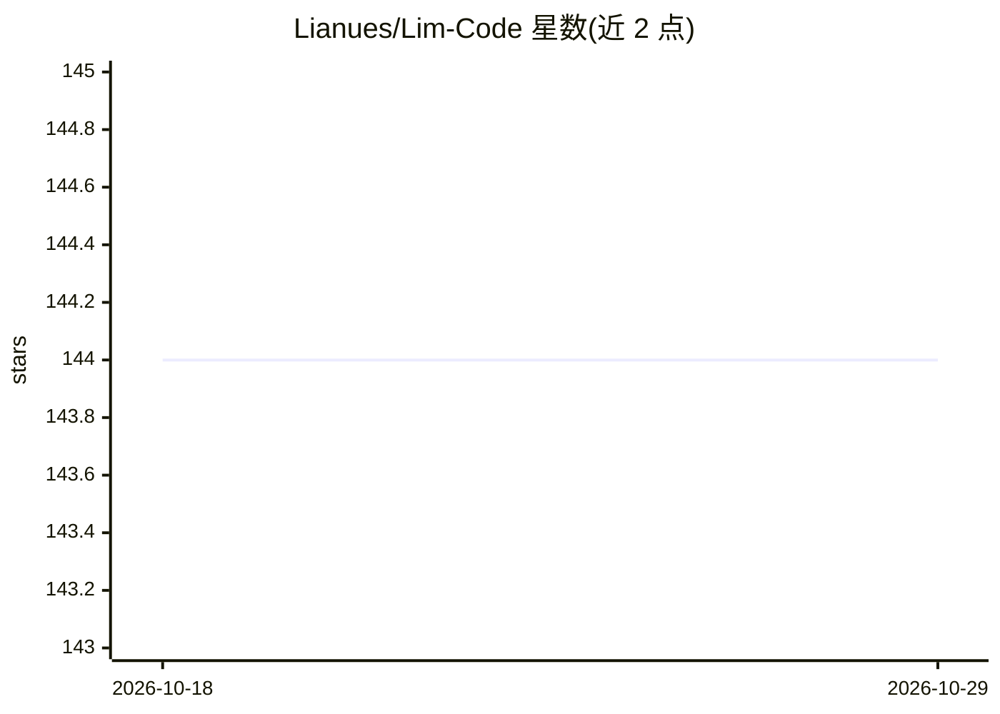

# Lianues/Lim-Code

⭐ 144 · TypeScript · MIT · 推送 2026-05-31 · [GitHub](https://github.com/Lianues/Lim-Code) · [官网](https://github.com/Lianues/Lim-Code) · 组织维护 · 中文 README

**VS Code AI 编程助手扩展：多模型对话、工具调用与代码操作**

VS Code 扩展，面向在编辑器内使用 AI 编程助手的开发者。支持 Gemini、OpenAI 兼容格式（含 Azure OpenAI）、Anthropic Claude 及自定义 XML 工具调用格式，用户自行填入 API URL 与 Key。内置文件读写、差异修改、终端命令执行、图像生成与处理等工具，支持 MCP 协议（Stdio/HTTP）连接外部工具服务器。提供工作区文件树上下文、对话历史、自动存档点与长对话压缩。安装途径为插件商店、VSIX 文件或源码构建。

## 筛选速览

| 维度 | 判定 | 备注 |
|---|---|---|
| AI 角色 | `ai-native` | 本体是模型或模型工具 |
| 许可风险 | `permissive` | MIT |
| 部署形态 | `None` |  |
| 模型依赖 | locked-api |  |
| 硬件要求 | — | 无带数字的原话,不猜 |
| 安装摩擦 | `low` | 无编译、无系统依赖或容器化 |
| 成熟度 | — | 结构信号不足 |

## 能力要点

- 多渠道模型支持（Gemini/OpenAI 兼容/Anthropic/自定义 XML 工具调用格式）
- 内置文件操作、终端执行、图像生成与处理等工具系统
- MCP 协议支持（Stdio 与 HTTP），可连接外部 MCP 服务器
- 会话管理含自动存档点代码备份与上下文自动压缩

## 适用场景

- 在 VS Code 内通过对话让 AI 直接读写与修改代码
- 通过 MCP 服务器扩展 AI 的工具能力
- 配置多个模型渠道并按需切换使用

## 场景标签

`编码 Agent` · 领域:编码与开发

## 证据(README 行号)

> L9:  一个强大的 VS Code AI 编程助手
> L22: ### 🤖 多渠道支持
> L28: ### 🛠️ 智能工具系统

## 星数曲线

2026-10-18 144 → 2026-10-29 144（+0）

---
*卡片 v1 · prompt 1.4 · 生成 2026-10-22 · 置信度 high · 依据 README sha `3abc1c34290c` · [字段定义](../../DATASET.md)*
