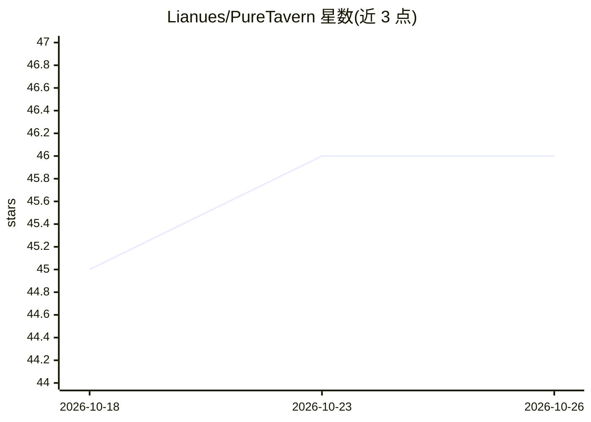

# Lianues/PureTavern

⭐ 46 · JavaScript · AGPL-3.0 · 推送 2026-10-13 · [GitHub](https://github.com/Lianues/PureTavern) · 个人维护 · 中文 README

**无需后端的 SillyTavern 第三方纯前端角色扮演客户端**

以 SillyTavern 为上游的第三方客户端，保留原版界面、提示词系统与前端扩展兼容层，去掉 Node.js 服务端依赖：角色、聊天、世界书、密钥等数据存于浏览器 IndexedDB，密钥不上传维护者服务器。默认纯前端部署到静态托管，可选 Python/Node.js/Go 远程代理转发聊天补全请求并透传 SSE；另提供 Android、iOS、HarmonyOS、桌面（Tauri 2）外壳与 VS Code 扩展。纯 Web 模式受 CORS/TLS/PNA 限制，IPA/HAP 默认未签名。

## 筛选速览

| 维度 | 判定 | 备注 |
|---|---|---|
| AI 角色 | `ai-native` | 本体是模型或模型工具 |
| 许可风险 | `viral` | AGPL-3.0 |
| 部署形态 | `desktop` | 安装包/桌面程序 |
| 模型依赖 | — | README 未给出锁定关系 |
| 硬件要求 | — | 无带数字的原话,不猜 |
| 安装摩擦 | `medium` | 含编译或系统依赖之一 |
| 成熟度 | — | 结构信号不足 |

## 能力要点

- 纯前端运行，无需 SillyTavern Node.js 服务端，数据存 IndexedDB
- 可选 Python/Node.js/Go 远程代理，转发聊天补全并透传 SSE，不存储密钥
- Android/iOS/HarmonyOS/桌面/VS Code 多平台外壳复用同一 Web 产物
- ZIP 数据导入导出与恢复点，Service Worker 静态资源缓存

## 适用场景

- 在静态托管或浏览器中直接使用 SillyTavern 式角色扮演聊天
- 通过手机或桌面外壳本地传输访问自配的聊天补全服务
- 不部署后端服务器的轻量化酒馆前端方案

## 场景标签

`聊天机器人` · 领域:对话与助手

## 证据(README 行号)

> L3: PureTavern 是一个以 SillyTavern 为上游的第三方客户端，采用“纯前端 + 可选后端”的设计。
> L23: - 不需要运行 SillyTavern Node.js 服务端；
> L28: - 支持浏览器直连允许 CORS 的聊天补全服务平台；

## 星数曲线

2026-10-18 45 → 2026-10-26 46（+1）

---
*卡片 v1 · prompt 1.4 · 生成 2026-10-25 · 置信度 mid · 依据 README sha `0c5993b68571` · [字段定义](../../DATASET.md)*
