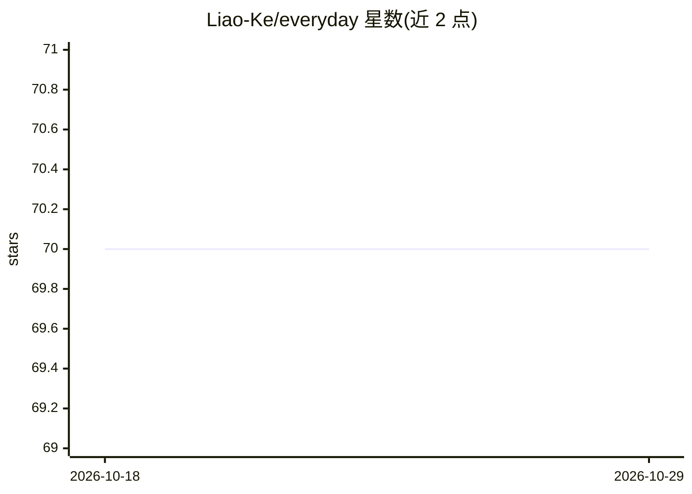

# Liao-Ke/everyday

⭐ 70 · Markdown · MIT · 推送 2026-10-28 · [GitHub](https://github.com/Liao-Ke/everyday) · [官网](https://liao-ke.github.io/everyday/) · 个人维护 · 中文 README

**基于金山每日一句用多个 LLM 并行生成故事的 Python 工具**

读取金山词霸每日一句，通过 ThreadPoolExecutor 并行调用 7+ 个 AI 模型（DeepSeek、智谱、Kimi、豆包、通义千问、ModelScope、Gemini）生成创意故事，保存为 Markdown 文件，由 VitePress 静态站点展示。采用插件式模型配置，每个模型一个配置文件导出 6 个标准化符号即可注册；流水线架构（预处理→chat→后处理→持久化）。附带词云分析脚本与 GitHub Actions 每日自动生成部署。面向开发者，运行需配置各模型 API 密钥。

## 筛选速览

| 维度 | 判定 | 备注 |
|---|---|---|
| AI 角色 | `ai-native` | 本体是模型或模型工具 |
| 许可风险 | `permissive` | MIT |
| 部署形态 | `library` | 以包/库形式分发 |
| 模型依赖 | locked-api |  |
| 硬件要求 | — | 无带数字的原话,不猜 |
| 安装摩擦 | `low` | 无编译、无系统依赖或容器化 |
| 成熟度 | — | 结构信号不足 |

## 能力要点

- 7+ AI 模型并行生成故事，ThreadPoolExecutor 并发运行
- 插件式模型配置：新增模型无需修改核心代码
- PREPROCESSORS→chat→POSTPROCESSORS→持久化的可插拔流水线
- GitHub Actions 每日自动生成 + Cloudflare Pages 部署

## 适用场景

- 每日自动生成基于经典名言的 AI 故事并发布为静态站点
- 对比多个 LLM 对同一句名言的生成效果
- 通过插件机制扩展自己常用的模型

## 场景标签

`AI 写作` · 领域:内容生成

## 证据(README 行号)

> L6: 根据金山词霸每日一句，通过多个 AI 模型并行生成故事，保存为 Markdown 文件，由 VitePress 静态站点展示。
> L10: - **多模型并行**：同时调用 7+ AI 模型（DeepSeek、智谱、Kimi、豆包、通义千问、ModelScope、Gemini），ThreadPoolExecutor 并发运行

## 星数曲线

2026-10-18 70 → 2026-10-29 70（+0）

---
*卡片 v1 · prompt 1.4 · 生成 2026-10-24 · 置信度 mid · 依据 README sha `d8ac76a78e74` · [字段定义](../../DATASET.md)*
