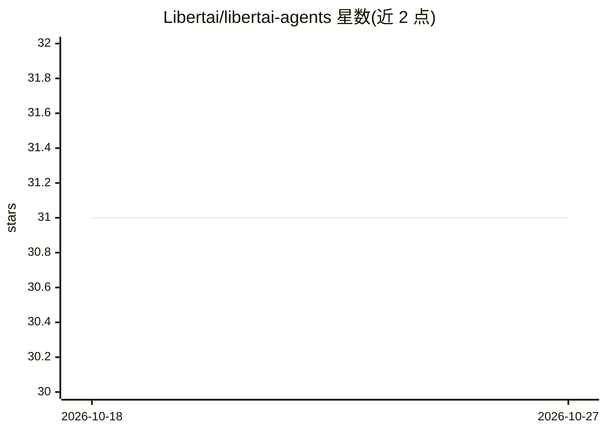

# Libertai/libertai-agents

⭐ 31 · TypeScript · MIT · 推送 2026-10-20 · [GitHub](https://github.com/Libertai/libertai-agents) · 组织维护

**在 Aleph Cloud 上构建自治 AI Agent 的插件与工具集**

LibertAI 维护的 agents 工具库，提供 x402 与 agentkit-plugin 两个包（TypeScript 与 Python 双语言发布）。x402 提供 HTTP 客户端封装，兼容 OpenAI SDK 与任意 HTTP 客户端；agentkit-plugin 将 Coinbase AgentKit 与 x402 驱动的 LLM 客户端及 Aleph Cloud 去中心化算力结合，用于构建为自身计算与推理付费的自治 agent。附带 TypeScript 与 Python 示例，支持通过 libertai-client CLI 部署 agent。README 内容简短，机制细节需查阅部署文档。

## 筛选速览

| 维度 | 判定 | 备注 |
|---|---|---|
| AI 角色 | `ai-ecosystem` | LLM/agent 周边工具 |
| 许可风险 | `permissive` | MIT |
| 部署形态 | `library` | 以包/库形式分发 |
| 模型依赖 | — | README 未给出锁定关系 |
| 硬件要求 | — | 无带数字的原话,不猜 |
| 安装摩擦 | `low` | 无编译、无系统依赖或容器化 |
| 成熟度 | — | 结构信号不足 |

## 能力要点

- x402 HTTP 客户端封装，兼容 OpenAI SDK 与任意 HTTP 客户端
- agentkit-plugin：Coinbase AgentKit + x402 LLM 客户端 + Aleph Cloud 去中心化算力
- TypeScript 与 Python 双语言包，均发布到 npm 与 PyPI
- 提供自治 agent 的 TypeScript/Python 工作示例与 CLI 部署

## 适用场景

- 构建能自行支付计算与推理费用的自治 agent
- 将 Coinbase AgentKit 接入 x402 支付与 Aleph Cloud 去中心化算力
- 在自有 HTTP 客户端或 OpenAI SDK 中使用 x402

## 场景标签

`Agent 框架` · 领域:Agent 开发

## 证据(README 行号)

> L5: Tools and integrations for building **self-sustaining AI agents** that pay for their own compute and inference.
> L12: |**agentkit-plugin**|npm|PyPI|Coinbase AgentKit with an x402-powered LLM client & decentralize compute powered by A

## 星数曲线

2026-10-18 31 → 2026-10-27 31（+0）

---
*卡片 v1 · prompt 1.4 · 生成 2026-10-26 · 置信度 mid · 依据 README sha `42587989bcc3` · [字段定义](../../DATASET.md)*
