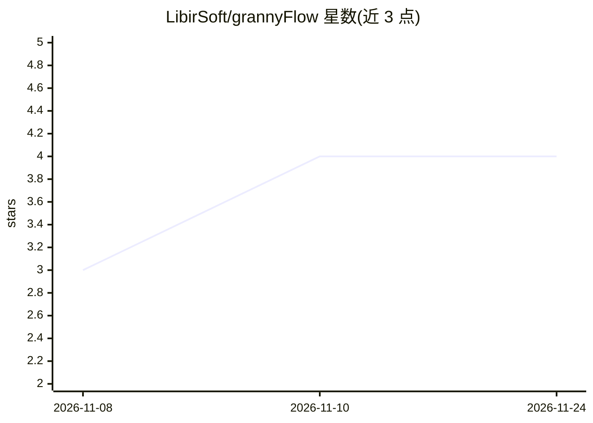

# LibirSoft/grannyFlow

⭐ 4 · TypeScript · MIT · 推送 2026-11-22 · [GitHub](https://github.com/LibirSoft/grannyFlow) · 个人维护

**把开发计划变成可提 PR 分支的多 agent 代码审查工作流技能**

以 agent 技能形式安装到 Claude Code、opencode、omp 等编码代理宿主的代码工作流工具：planner 先写计划，implementer 按阶段构建并提交，多个 reviewer 并行审查，judge 按影响、可能性与修复成本对发现项评级，代码化的阈值决定哪些回炉修复，循环至审查通过。运行在独立 git worktree 中，不触碰主检出，产物为分支、PR 正文与报告，不自动推送。支持 Claude Code 上的确定性 Workflow 脚本执行，Cursor 上为手动跟随步骤。

## 筛选速览

| 维度 | 判定 | 备注 |
|---|---|---|
| AI 角色 | `ai-ecosystem` | LLM/agent 周边工具 |
| 许可风险 | `permissive` | MIT |
| 部署形态 | `library` | 以包/库形式分发 |
| 模型依赖 | — | README 未给出锁定关系 |
| 硬件要求 | — | 无带数字的原话,不猜 |
| 安装摩擦 | `low` | 无编译、无系统依赖或容器化 |
| 成熟度 | — | 结构信号不足 |

## 能力要点

- implementer/reviewer/judge 多角色循环，阈值化决定修复范围
- 在分支独立 git worktree 中运行，主检出不被修改
- 支持 Claude Code、opencode、omp 宿主，Cursor 手动执行
- 审查轮次可回帖到 GitHub PR 或 GitLab MR，逐行定位发现项

## 适用场景

- 让 agent 按计划文件分阶段实现功能并自动过审
- 只用 granny judge 对现有分支做只读代码审查
- 在 PR 上留下每轮审查的裁决记录与逐行评论

## 场景标签

`多智能体` `代码审查` `编码 Agent` · 领域:Agent 开发

## 证据(README 行号)

> L3: Granny turns a plan into a PR-ready branch. An **implementer** agent builds the plan stage by stage, **reviewers** c
> L7: It runs on Claude Code, opencode and omp (oh-my-pi), where the loop is code, so the round cap and the thresholds hol

## 星数曲线

2026-11-08 3 → 2026-11-24 4（+1）

---
*卡片 v1 · prompt 1.4 · 生成 2026-11-21 · 置信度 high · 依据 README sha `c9be2df62148` · [字段定义](../../DATASET.md)*
