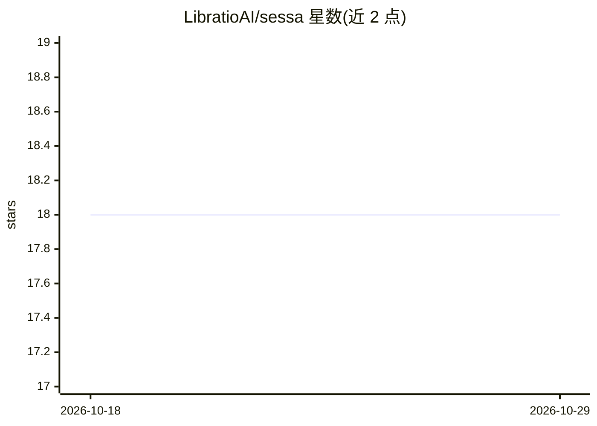

# LibratioAI/sessa

⭐ 18 · Python · Apache-2.0 · 推送 2026-04-28 · [GitHub](https://github.com/LibratioAI/sessa) · 组织维护

**结合自注意力与递归反馈的解码器架构研究代码**

Sessa 是一种解码器架构：将自注意力集成到递归反馈通路中，结合输入依赖的注意力路由与基于反馈的递归聚合，用于序列建模与长上下文信息保持，定位对标标准 Transformer 与 Mamba 等 SSM 模型。以 PyTorch 库形式提供，通过 git clone 后 pip 可编辑安装，提供 SessaLayer 模块供代码调用；可选启用 FlashAttention（默认关闭，未安装时回退到参考注意力实现），论文见 arXiv。

## 筛选速览

| 维度 | 判定 | 备注 |
|---|---|---|
| AI 角色 | `ai-native` | 本体是模型或模型工具 |
| 许可风险 | `permissive` | Apache-2.0 |
| 部署形态 | `library` | 以包/库形式分发 |
| 模型依赖 | — | README 未给出锁定关系 |
| 硬件要求 | — | 无带数字的原话,不猜 |
| 安装摩擦 | `medium` | 含编译或系统依赖之一 |
| 成熟度 | — | 结构信号不足 |

## 能力要点

- 自注意力嵌入递归反馈通路的解码器架构
- 输入依赖的注意力路由 + 反馈式递归聚合
- 提供 SessaLayer PyTorch 模块与 Quickstart 示例
- 可选 FlashAttention 支持（默认禁用，自动回退参考实现）

## 适用场景

- 研究长上下文序列建模范式
- 在自有 PyTorch 实验中替换/对比 Transformer 与 SSM 层
- 复现论文实验或基于该架构做改进

## 场景标签

 · 领域:深度学习/序列建模

## 证据(README 行号)

> L11: Sessa is a decoder architecture that integrates self-attention into a recurrent feedback pathway.
> L13: It combines input-dependent attention routing with feedback-based recurrent aggregation, aiming to improve long-con

## 星数曲线

2026-10-18 18 → 2026-10-29 18（+0）

---
*卡片 v1 · prompt 1.4 · 生成 2026-10-29 · 置信度 mid · 依据 README sha `35105d17a87d` · [字段定义](../../DATASET.md)*
