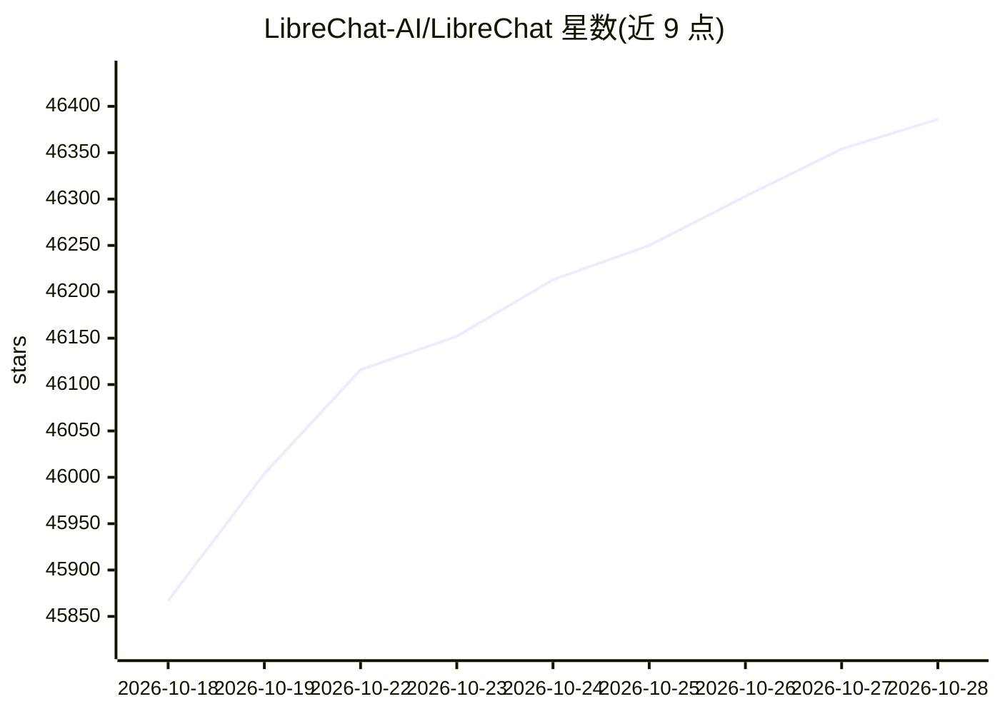

# LibreChat-AI/LibreChat

⭐ 46,431 · TypeScript · MIT · 推送 2026-10-28 · [GitHub](https://github.com/LibreChat-AI/LibreChat) · [官网](https://librechat.ai/) · 组织维护 · 中文 README

**自托管多模型 AI 聊天平台：统一接入多家服务商**

自托管的 AI 对话平台，将多家模型服务商统一在一个界面中，支持自定义端点（任何 OpenAI 兼容 API）。提供 Agent 构建与市场、MCP 工具接入、SKILL.md 技能包、代码解释器沙箱（Python/Node.js/Go 等多语言）、联网搜索、图像生成、Artifacts、语音输入输出、消息搜索与导入导出。多用户场景支持 OAuth2/LDAP/邮箱登录、管理面板与按角色权限配置，可单机或配合 Redis 水平扩展部署，提供 Docker Compose 一键部署栈。

## 筛选速览

| 维度 | 判定 | 备注 |
|---|---|---|
| AI 角色 | `ai-native` | 本体是模型或模型工具 |
| 许可风险 | `permissive` | MIT |
| 部署形态 | `desktop` | 安装包/桌面程序 |
| 模型依赖 | local-ok | 支持本地模型 |
| 硬件要求 | — | 无带数字的原话,不猜 |
| 安装摩擦 | `low` | 无编译、无系统依赖或容器化 |
| 成熟度 | — | 结构信号不足 |

## 动量与使用信号

- 维护:`active` — 距上次 push 0.7 天,年发版 35,411 位贡献者
- 涨星:近 1 天 **+80**(自 20261016 起算)
- 平台:— · 协议:OPENAI-API / MCP / OLLAMA

## 能力要点

- 统一界面接入多家模型服务商，支持任意 OpenAI 兼容自定义端点
- Agent 体系：无代码构建、市场分享、子代理、MCP 与 SKILL.md 技能
- 沙箱化代码解释器支持 Python、Node.js、Go、C/C++ 等语言
- 多用户安全认证（OAuth2/LDAP）、管理面板与 Token 用量工具

## 适用场景

- 自建一个统一管理多家模型接口的私有聊天界面
- 为团队部署带用户权限与用量统计的多用户 AI 助手
- 通过 MCP 和 Agent 给 AI 接入自定义工具与文件搜索
- 导入既有 ChatGPT 对话记录做统一管理

## 场景标签

`聊天机器人` `AI 助手` · 领域:对话与助手

## 证据(README 行号)

> L63: - 🤖 **AI Model Selection**:
> L173: LibreChat is a self-hosted AI chat platform that unifies all major AI providers in a single, privacy-focused inter
> L175: Beyond chat, LibreChat provides AI Agents, Model Context Protocol (MCP) support, Artifacts, Code Interpreter, cust

## 星数曲线

2026-10-18 45,867 → 2026-10-28 46,386（+519）

---
*卡片 v1 · prompt 1.4 · 生成 2026-10-18 · 置信度 high · 依据 README sha `30b92eac4816` · [字段定义](../../DATASET.md)*
