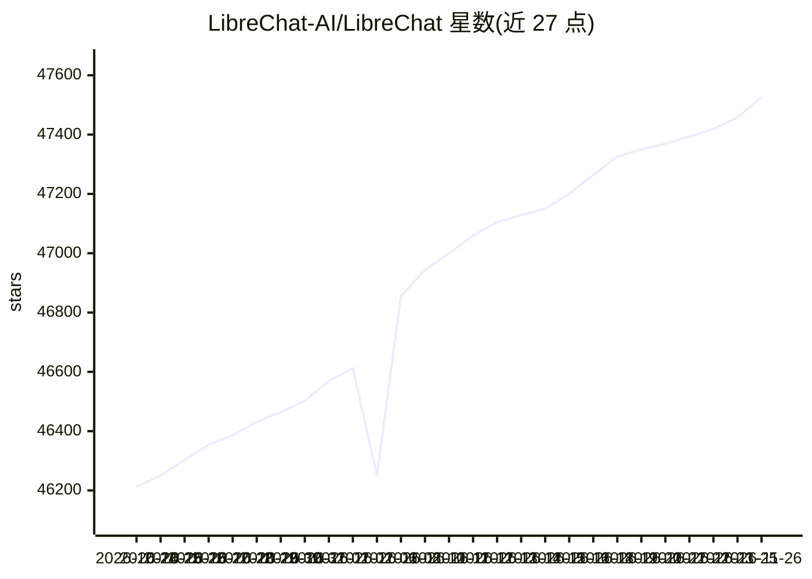

# LibreChat-AI/LibreChat

⭐ 47,526 · TypeScript · MIT · 推送 2026-11-25 · [GitHub](https://github.com/LibreChat-AI/LibreChat) · [官网](https://librechat.ai/) · 组织维护 · 中文 README

**自托管多模型 AI 聊天平台，统一接入多家 AI 服务**

LibreChat 是一个自托管的 AI 聊天平台，在单一界面中统一接入多家 AI 服务，并提供 Agents、MCP 工具支持、Code Interpreter（基于沙箱执行多种语言）、Artifacts、网络搜索、图像生成、语音对话、会话导入导出与全文搜索。面向重视自控 AI 基础设施的用户与团队，支持多用户认证（OAuth2/LDAP/邮箱）、管理面板、可观测性导出（OpenTelemetry/Langfuse）及 Redis 水平扩展部署。界面提供多语言（含简繁中文）定制。

## 筛选速览

| 维度 | 判定 | 备注 |
|---|---|---|
| AI 角色 | `ai-ecosystem` | LLM/agent 周边工具 |
| 许可风险 | `permissive` | MIT |
| 部署形态 | `desktop` | 安装包/桌面程序 |
| 模型依赖 | local-ok | 支持本地模型 |
| 硬件要求 | — | 无带数字的原话,不猜 |
| 安装摩擦 | `low` | 无编译、无系统依赖或容器化 |
| 成熟度 | — | 结构信号不足 |

## 动量与使用信号

- 维护:`active` — 距上次 push 0.7 天,年发版 35,411 位贡献者
- 涨星:近 1 天 **+80**(自 20261016 起算)
- 平台:— · 协议:OPENAI-API / MCP / OLLAMA

## 能力要点

- 自定义端点支持任意 OpenAI 兼容 API，无需代理
- No-Code 自定义助手、Agent 市场、子代理与 SKILL.md 技能机制
- Code Interpreter API 沙箱执行 Python/Node.js/Go 等 9 种语言
- 多用户安全认证（OAuth2、LDAP、邮箱）与管理面板

## 适用场景

- 团队自托管一个统一界面接入多家模型服务
- 为组织搭建带权限管理的多用户 AI 对话平台
- 构建可调用 MCP 工具与代码执行的 Agent 工作流
- 离线/私有化环境接入本地模型（如 Ollama）

## 场景标签

`聊天机器人` `AI 助手` · 领域:对话与助手

## 证据(README 行号)

> L170: LibreChat is a self-hosted AI chat platform that unifies all major AI providers in a single, privacy-focused inter
> L172: Beyond chat, LibreChat provides AI Agents, Model Context Protocol (MCP) support, Artifacts, Code Interpreter, cust
> L62:  - Custom Endpoints: Use any OpenAI-compatible API with LibreChat, no proxy required

## 星数曲线

2026-10-24 46,213 → 2026-11-26 47,526（+1,313）

---
*卡片 v1 · prompt 1.4 · 生成 2026-11-22 · 置信度 high · 依据 README sha `9409ae8d74ff` · [字段定义](../../DATASET.md)*
