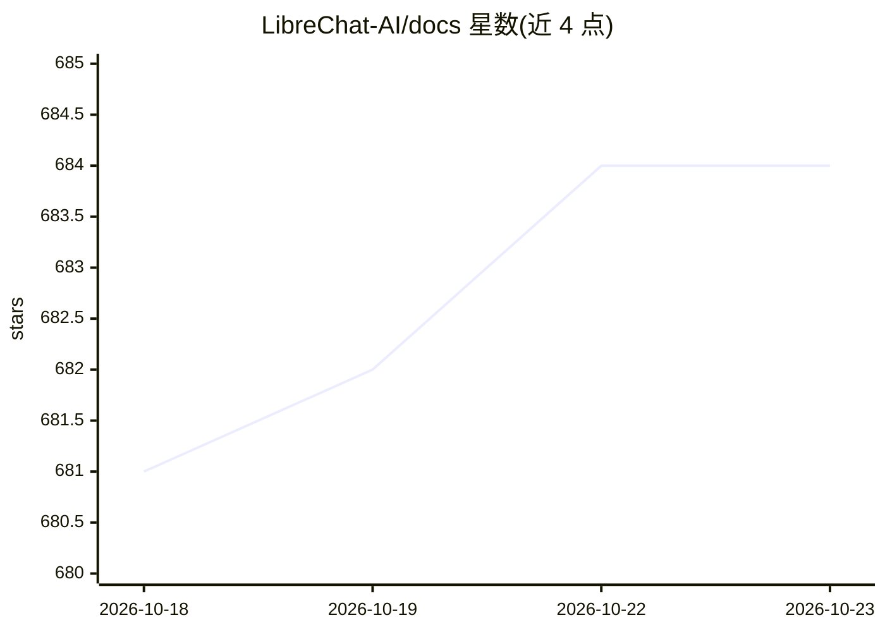

# LibreChat-AI/docs

⭐ 684 · MDX · MIT · 推送 2026-10-22 · [GitHub](https://github.com/LibreChat-AI/docs) · [官网](https://www.librechat.ai) · 组织维护

**LibreChat 官方文档站：覆盖安装、配置与版本变更日志**

LibreChat（开源自托管 AI 聊天平台）的官方文档、博客与变更日志仓库，构建为 Next.js 16 + Fumadocs 的站点，内容以 MDX 编写并支持 14 种语言。提供基于 Orama 的客户端全文搜索（每语言预建静态索引）、基于 Vercel AI SDK + OpenRouter 的页内问答助手、版本化文档快照机制，以及 Ed25519 签名的 Web Bot Auth。本地开发需 Node.js 22.x–24.x 与 pnpm 9.5+。限制：文档归档仅始于 v0.8.2，且归档数量受构建内存与 webpack 字符串长度上限约束。

## 筛选速览

| 维度 | 判定 | 备注 |
|---|---|---|
| AI 角色 | `ai-knowledge` | 知识聚合/清单类 |
| 许可风险 | `permissive` | MIT |
| 部署形态 | `None` |  |
| 模型依赖 | — | README 未给出锁定关系 |
| 硬件要求 | — | 无带数字的原话,不猜 |
| 安装摩擦 | `low` | 无编译、无系统依赖或容器化 |
| 成熟度 | `idea` | |

## 能力要点

- Next.js 16 + Fumadocs 构建的 MDX 文档站点，支持 14 种语言与 CJK/韩语等专用分词器
- Orama 客户端全文搜索，每语言预建静态索引
- Ask AI 页内助手（Vercel AI SDK + OpenRouter）回答基于文档的问题
- 版本化文档快照（content/docs-archive），附 pnpm docs:archive 发布命令

## 适用场景

- 查找 LibreChat 的安装、配置与部署指南
- 查阅各版本发布说明与配置版本变更
- 为开源项目搭建多语言、带站内搜索与 AI 问答的文档站

## 场景标签

 · 领域:开发者文档/知识站点

## 证据(README 行号)

> L7:  The official documentation, blog, and changelog for
> L8:  LibreChat,
> L44: This repository powers **www.librechat.ai**: the docs, guides, blog, and changelog for LibreChat. It is a Next.js a

## 星数曲线

2026-10-18 681 → 2026-10-23 684（+3）

---
*卡片 v1 · prompt 1.4 · 生成 2026-10-21 · 置信度 high · 依据 README sha `39750f4e9584` · [字段定义](../../DATASET.md)*
