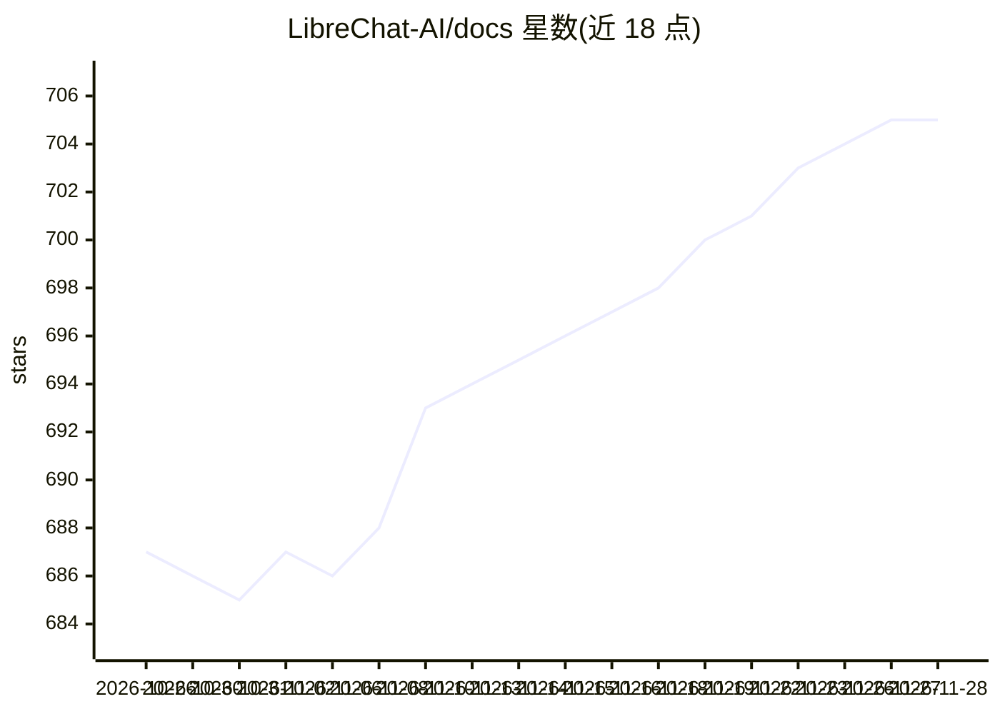

# LibreChat-AI/docs

⭐ 705 · MDX · MIT · 推送 2026-11-27 · [GitHub](https://github.com/LibreChat-AI/docs) · [官网](https://www.librechat.ai) · 组织维护

**LibreChat 官方文档、博客与更新日志站点（librechat.ai）**

本仓库承载 LibreChat 开源自托管 AI 聊天平台的官方文档、博客与更新日志，以 Next.js 16 + Fumadocs + MDX 构建，部署于 www.librechat.ai。文档内容按目录分节、meta.json 控制侧边栏；支持 14 种语言翻译及分语言的静态搜索索引（Orama）；每个发布版本自动归档为冻结快照并提供版本切换。站内含 Ask AI 页内助手（Vercel AI SDK + OpenRouter，基于文档作答）。运行需 Node.js 22.x–24.x 与 pnpm；Ask AI 与限流功能需配置环境变量。

## 筛选速览

| 维度 | 判定 | 备注 |
|---|---|---|
| AI 角色 | `ai-knowledge` | 知识聚合/清单类 |
| 许可风险 | `permissive` | MIT |
| 部署形态 | `None` |  |
| 模型依赖 | locked-api |  |
| 硬件要求 | — | 无带数字的原话,不猜 |
| 安装摩擦 | `low` | 无编译、无系统依赖或容器化 |
| 成熟度 | — | 结构信号不足 |

## 能力要点

- 14 种语言的翻译文档与分语言静态全文搜索索引
- 每个发布版本自动归档为只读英文快照并支持版本切换
- 页内 Ask AI 助手基于 Vercel AI SDK + OpenRouter 以文档内容作答
- cookieless 自托管分析，无追踪横幅

## 适用场景

- 查找 LibreChat 的安装、配置与部署说明
- 按版本查阅历史发布文档快照
- 为 LibreChat 贡献或翻译文档内容

## 场景标签

 · 领域:开发者文档/文档站点

## 证据(README 行号)

> L5:  LibreChat Documentation
> L44: This repository powers **www.librechat.ai**: the docs, guides, blog, and changelog for LibreChat. It is a Next.js a
> L52: - 📚 **Complete documentation** covering setup, configuration, deployment, and every LibreChat feature.

## 星数曲线

2026-10-26 687 → 2026-11-28 705（+18）

---
*卡片 v1 · prompt 1.4 · 生成 2026-11-28 · 置信度 high · 依据 README sha `9b8f9aa07894` · [字段定义](../../DATASET.md)*
