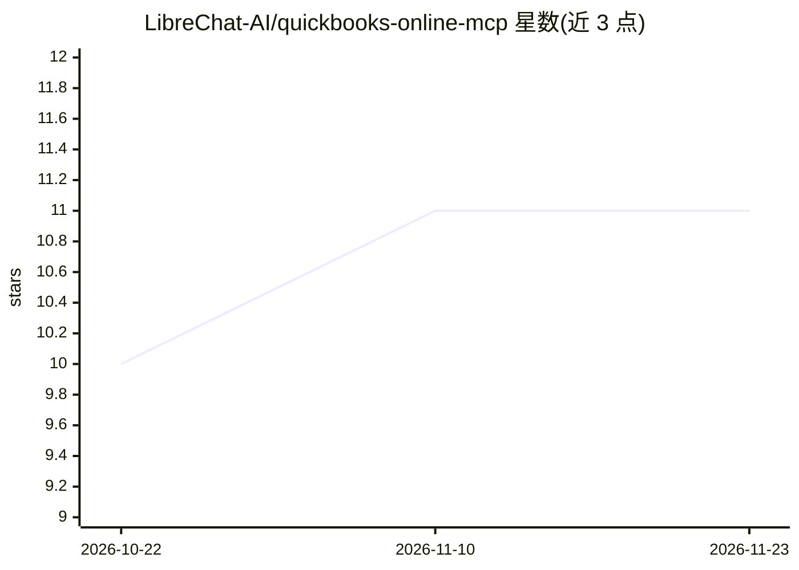

# LibreChat-AI/quickbooks-online-mcp

⭐ 11 · TypeScript · Apache-2.0 · 推送 2026-08-15 · [GitHub](https://github.com/LibreChat-AI/quickbooks-online-mcp) · [官网](https://librechat.ai) · 组织维护

**为 MCP 客户端提供 QuickBooks Online 55 个工具的服务器**

基于 Cloudflare Workers 构建的 Model Context Protocol 服务器，通过 OAuth 2.0 连接 QuickBooks Online，提供 55 个工具覆盖 11 种实体（客户、发票、账单、供应商等）的增删改查与条件搜索，使用 Zod 类型化 schema 与 Streamable HTTP/SSE 传输，与 LibreChat 等 MCP 客户端兼容。部署需自建 Intuit 开发者凭据；生产环境要求 QBO 订阅并通过 Intuit 应用审核，沙箱免费。

## 筛选速览

| 维度 | 判定 | 备注 |
|---|---|---|
| AI 角色 | `ai-ecosystem` | LLM/agent 周边工具 |
| 许可风险 | `permissive` | Apache-2.0 |
| 部署形态 | `library` | 以包/库形式分发 |
| 模型依赖 | — | README 未给出锁定关系 |
| 硬件要求 | — | 无带数字的原话,不猜 |
| 安装摩擦 | `low` | 无编译、无系统依赖或容器化 |
| 成熟度 | — | 结构信号不足 |

## 能力要点

- 55 个工具覆盖 11 种 QuickBooks 实体的 CRUD 与结构化搜索
- OAuth 2.0 代理与授权发现端点（/.well-known/oauth-authorization-server）
- 更新/删除工具自动获取 SyncToken，仅需提供 Id 与变更字段
- 运行于 Cloudflare Workers，纯 fetch 调用 QuickBooks REST API

## 适用场景

- 让 LibreChat 等 MCP 客户端通过对话管理 QuickBooks 发票与账单
- 在 Intuit 免费沙箱中测试 QuickBooks 集成
- 为 QuickBooks 数据接入构建自己的 MCP 客户端连接

## 场景标签

 · 领域:LLM 基础设施/MCP 工具服务

## 证据(README 行号)

> L3: A Model Context Protocol server for QuickBooks Online, built on Cloudflare Workers with OAuth 2.0 authentication.
> L5: Provides 55 tools for managing QuickBooks entities (customers, invoices, bills, vendors, etc.) via any MCP-compatibl
> L11: - **McpAgent** (from `agents` package) for MCP transport (SSE + Streamable HTTP)

## 星数曲线

2026-10-22 10 → 2026-11-23 11（+1）

---
*卡片 v1 · prompt 1.4 · 生成 2026-11-19 · 置信度 high · 依据 README sha `3b18df76b9ec` · [字段定义](../../DATASET.md)*
