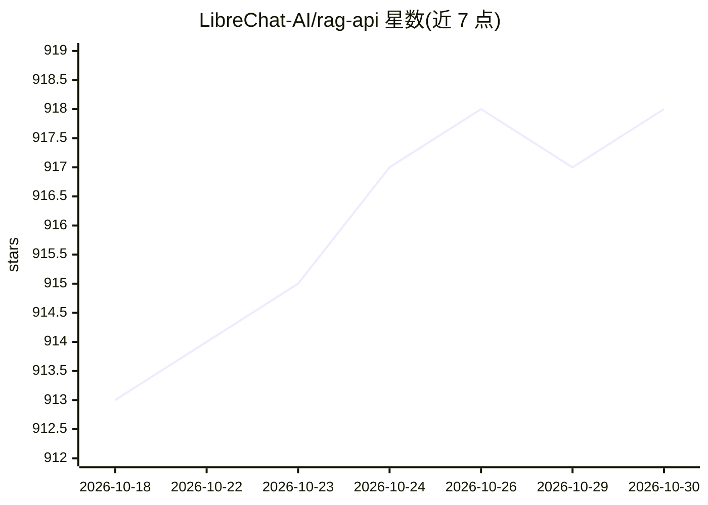

# LibreChat-AI/rag-api

⭐ 918 · Python · MIT · 推送 2026-10-23 · [GitHub](https://github.com/LibreChat-AI/rag-api) · [官网](https://librechat.ai/) · 组织维护

**基于 FastAPI 的 ID 级文档索引与检索 RAG API 服务**

将 Langchain 与 FastAPI 以异步方式结合的 RAG API：以 PostgreSQL/pgvector 为向量库，按 file_id 组织嵌入，提供文档增删查与检索接口。主要用例是与 LibreChat 集成，也可用于任意基于 ID 的场景。嵌入默认走 OpenAI API（可用 BASEURL/代理改接），提供 Docker Compose 与本地 pip+uvicorn 两种部署方式。本版本重点重构检索作用域：以 JWT 验证的 owner 集在排序前过滤 chunk，修复此前 /query_multiple 等路由越权读取与按 file_id 回滚删除他人数据的问题；entity_id 仍为调用方自证，需上游鉴权。

## 筛选速览

| 维度 | 判定 | 备注 |
|---|---|---|
| AI 角色 | `ai-ecosystem` | LLM/agent 周边工具 |
| 许可风险 | `permissive` | MIT |
| 部署形态 | `self-host` | docker 或自建部署 |
| 模型依赖 | — | README 未给出锁定关系 |
| 硬件要求 | — | 无带数字的原话,不猜 |
| 安装摩擦 | `low` | 无编译、无系统依赖或容器化 |
| 成熟度 | — | 结构信号不足 |

## 能力要点

- 按 file_id 组织嵌入，支持与 LibreChat 集成及任意 ID 场景
- 异步 FastAPI + Langchain 向量库，pgvector 为默认后端
- 检索前按 JWT 验证的 owner 集过滤，修复多项越权读写问题
- 支持 OpenAI 兼容 BASEURL/代理配置与 Docker Compose 部署

## 适用场景

- 为 LibreChat 或自建应用提供文档索引与检索后端
- 基于文件级 ID 做多用户隔离的 RAG 服务
- 以 pgvector 部署可私有化的向量检索 API

## 场景标签

`RAG` · 领域:知识与检索

## 证据(README 行号)

> L4: This project integrates Langchain with FastAPI in an Asynchronous, Scalable manner, providing a framework for docume
> L6: Files are organized into embeddings by `file_id`. The primary use case is for integration with LibreChat, but this s

## 星数曲线

2026-10-18 913 → 2026-10-30 918（+5）

---
*卡片 v1 · prompt 1.4 · 生成 2026-10-21 · 置信度 high · 依据 README sha `5b0061b2325c` · [字段定义](../../DATASET.md)*
