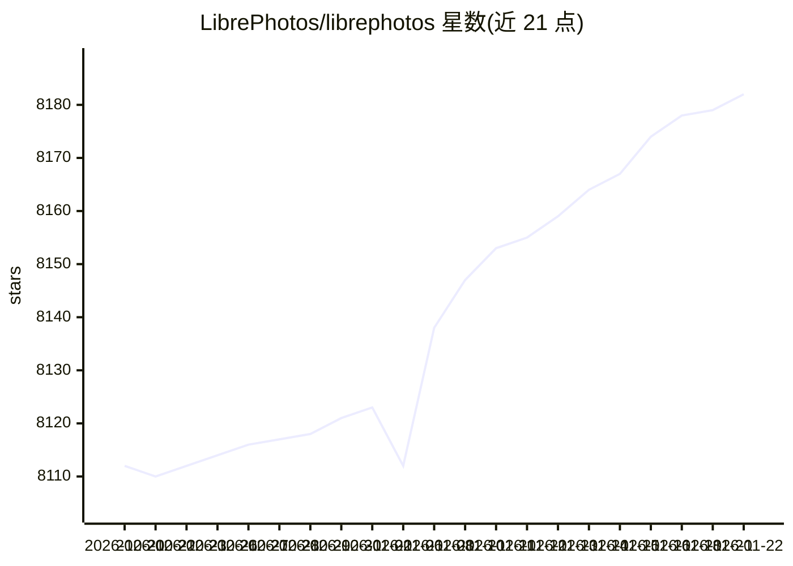

# LibrePhotos/librephotos

⭐ 8,182 · Python · MIT · 推送 2026-11-21 · [GitHub](https://github.com/LibrePhotos/librephotos) · [官网](https://docs.librephotos.com/) · 组织维护

**自托管照片管理服务：人脸识别、物体检测与语义搜索**

自托管的开源照片管理服务，由五个原仓库合并而成的 monorepo，含 Django 后端、React Web 客户端、Expo 移动端与文档站。核心功能包括时间线浏览、多用户与共享相册、人脸检测与聚类、基于 CLIP 的语义搜索、地图与逆地理编码、RAW/HEIC 等格式支持。所有模型经 ONNX Runtime 运行、不依赖 PyTorch；机器学习功能对内存要求较高，README 建议 8 GB 以上内存。部署方式覆盖单容器、Docker Compose、Kubernetes、Unraid 与 Windows 独立可执行文件。

## 筛选速览

| 维度 | 判定 | 备注 |
|---|---|---|
| AI 角色 | `ai-enhanced` | 去掉 AI 部分产品仍成立 |
| 许可风险 | `permissive` | MIT |
| 部署形态 | `desktop` | 安装包/桌面程序 |
| 模型依赖 | — | README 未给出锁定关系 |
| 硬件要求 | — | 无带数字的原话,不猜 |
| 安装摩擦 | `low` | 无编译、无系统依赖或容器化 |
| 成熟度 | — | 结构信号不足 |

## 能力要点

- 人脸检测与聚类：命名一人后自动建议其余照片
- 基于 CLIP ViT-B/32 的语义搜索与相似照片检索
- 全部 ML 模型经 ONNX Runtime 运行，无 PyTorch 依赖
- 支持单容器、Compose、Kubernetes、Unraid 与 Windows 独立可执行文件五种部署

## 适用场景

- 在自家服务器上集中管理照片和视频并自动打标签
- 按“沙滩上的狗”这类自然语言描述搜索照片
- 家庭多人共享相册与公开链接

## 场景标签

`语义搜索` `人脸识别` `目标检测` · 领域:知识与检索

## 证据(README 行号)

> L10: A self-hosted, open-source photo management service with automatic face recognition, object detection, and semantic
> L91: - **ML runtime:** ONNX Runtime for every model, no PyTorch

## 星数曲线

2026-10-20 8,112 → 2026-11-22 8,182（+70）

---
*卡片 v1 · prompt 1.4 · 生成 2026-11-22 · 置信度 high · 依据 README sha `137377da9274` · [字段定义](../../DATASET.md)*
