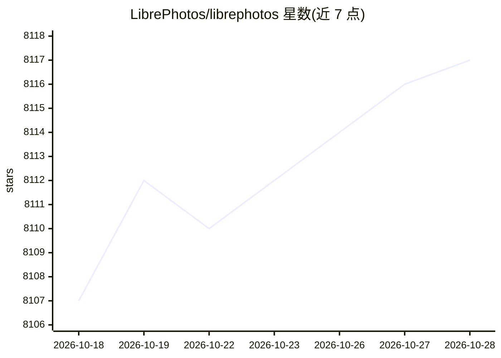

# LibrePhotos/librephotos

⭐ 8,117 · Python · MIT · 推送 2026-10-27 · [GitHub](https://github.com/LibrePhotos/librephotos) · [官网](https://docs.librephotos.com/) · 组织维护

**自托管照片管理服务：人脸识别、语义搜索的私有相册**

自托管开源照片管理服务，整合此前五个仓库为 monorepo：Django 5 后端 API、React 19 前端、Expo 移动端与 Docker/K8s 部署配置。机器学习功能包括 InsightFace 人脸检测与聚类（命名一次自动建议）、LFM2.5-VL 图像描述生成、OpenCLIP/CLIP 语义搜索与相似照片、标签生成；全部模型经 ONNX Runtime 运行，不依赖 PyTorch。支持 RAW/HEIC/JPEG XL、视频与实况照片、多用户共享相册、OpenID 单点登录。ML 功能内存消耗较高，官方建议 8GB+ 内存。

## 筛选速览

| 维度 | 判定 | 备注 |
|---|---|---|
| AI 角色 | `ai-enhanced` | 去掉 AI 部分产品仍成立 |
| 许可风险 | `permissive` | MIT |
| 部署形态 | `desktop` | 安装包/桌面程序 |
| 模型依赖 | — | README 未给出锁定关系 |
| 硬件要求 | — | 无带数字的原话,不猜 |
| 安装摩擦 | `low` | 无编译、无系统依赖或容器化 |
| 成熟度 | — | 结构信号不足 |

## 能力要点

- 人脸检测与聚类：命名一次后自动建议同人物照片
- 语义搜索（如 dog on a beach）基于 CLIP/OpenCLIP + FAISS
- 全部模型经 ONNX Runtime 运行，无 PyTorch 依赖
- 按日期地点分组的时间线、重复检测与事件自动生成相册

## 适用场景

- 我想要一个隐私自控的私人照片库，不想上传到云服务
- 给家人共享相册并用语义搜索快速找照片
- 自动按人物和地点整理多年积累的照片（含 RAW）

## 场景标签

`语义搜索` `人脸识别` · 领域:知识与检索

## 证据(README 行号)

> L10: A self-hosted, open-source photo management service with automatic face recognition, object detection, and semantic
> L55:  - Face detection and clustering: name a person once and the rest is suggested

## 星数曲线

2026-10-18 8,107 → 2026-10-28 8,117（+10）

---
*卡片 v1 · prompt 1.4 · 生成 2026-10-20 · 置信度 high · 依据 README sha `e0815909e864` · [字段定义](../../DATASET.md)*
