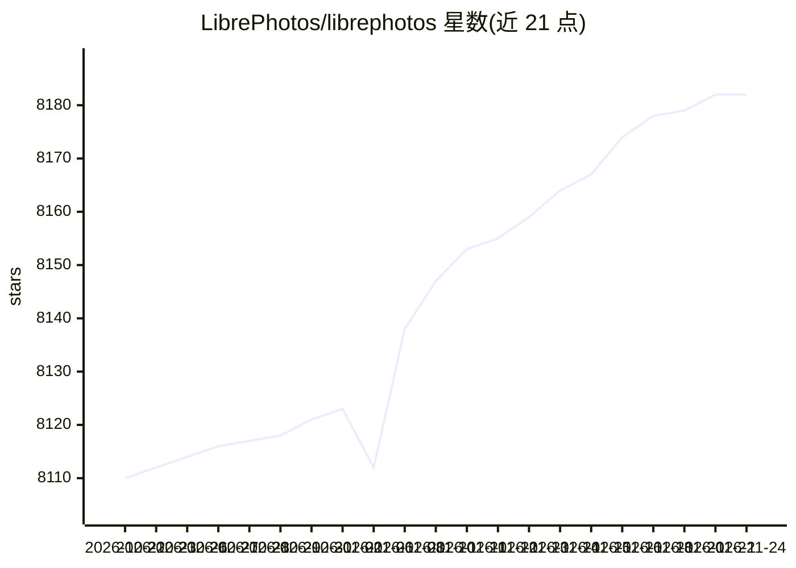

# LibrePhotos/librephotos

⭐ 8,183 · Python · MIT · 推送 2026-11-23 · [GitHub](https://github.com/LibrePhotos/librephotos) · [官网](https://docs.librephotos.com/) · 组织维护

**自托管开源照片管理服务，提供人脸识别与语义搜索**

自托管的多人照片管理服务：支持扫描既有文件夹与 Web/移动端上传，管理 RAW、HEIC、JPEG XL 等常见格式及视频。机器学习功能包括人脸检测与聚类、图像描述生成、基于 CLIP/OpenCLIP 的语义搜索与相似照片，所有模型经 ONNX Runtime 运行、不依赖 PyTorch。部署方式含单容器、Docker Compose（可选 NVIDIA GPU）、Kubernetes、Unraid 与 Windows 独立可执行文件；要求 PostgreSQL 数据库，机器学习功能内存消耗较大，推荐 8 GB 以上 RAM。

## 筛选速览

| 维度 | 判定 | 备注 |
|---|---|---|
| AI 角色 | `ai-enhanced` | 去掉 AI 部分产品仍成立 |
| 许可风险 | `permissive` | MIT |
| 部署形态 | `desktop` | 安装包/桌面程序 |
| 模型依赖 | — | README 未给出锁定关系 |
| 硬件要求 | — | 无带数字的原话,不猜 |
| 安装摩擦 | `low` | 无编译、无系统依赖或容器化 |
| 成熟度 | — | 结构信号不足 |

## 能力要点

- 人脸检测与聚类：命名一次人物后其余照片自动建议
- 基于 CLIP ViT-B/32 的语义搜索与相似照片检索
- 图像描述生成采用 LFM2.5-VL 并结合已识别人物与地点
- 全模型经 ONNX Runtime 运行，无 PyTorch 依赖

## 适用场景

- 在自有服务器上集中管理家庭照片库并自动整理人物相册
- 用自然语言语义搜索（如“沙滩上的狗”）查找照片
- 多用户共享相册并通过公开链接分享照片
- 在离线私有环境下使用人脸识别与图像描述功能

## 场景标签

`语义搜索` `人脸识别` · 领域:知识与检索

## 证据(README 行号)

> L10: A self-hosted, open-source photo management service with automatic face recognition, object detection, and semantic
> L86: - **Face detection:** InsightFace
> L91: - **ML runtime:** ONNX Runtime for every model, no PyTorch

## 星数曲线

2026-10-22 8,110 → 2026-11-24 8,182（+72）

---
*卡片 v1 · prompt 1.4 · 生成 2026-11-23 · 置信度 high · 依据 README sha `ddb95347bd15` · [字段定义](../../DATASET.md)*
