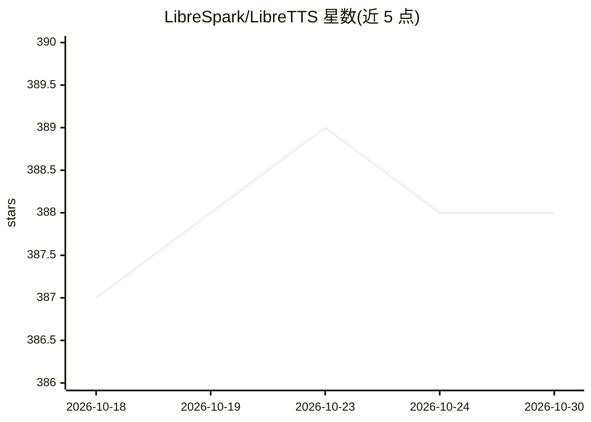

# LibreSpark/LibreTTS

⭐ 388 · TypeScript · MIT · 推送 2026-10-02 · [GitHub](https://github.com/LibreSpark/LibreTTS) · [官网](https://LibreTTS.is-an.org) · 个人维护 · 中文 README

**在线文本转语音 Web 前端，聚合 Edge/OpenAI 等多种 TTS 接口**

基于 Next.js（App Router）+ TypeScript + Tailwind CSS 的自托管文本转语音 Web 应用，曾用名 Ciallo TTS。前端支持 300+ 语言/口音声音、语速语调调节、长文本自动分段合成、试听下载与历史记录；后端提供 /api/tts、/api/voices 等 API 端点。可添加自定义 TTS API：兼容 OpenAI 格式、Microsoft Edge TTS 格式，或用请求模板对接任意 HTTP TTS 服务，内置 ElevenLabs、硅基流动、MiniMax 等常见服务预设，配置可导入导出。部署支持 Vercel、Docker（GHCR 官方镜像，amd64/arm64）与 Node.js 源码运行，提供可选访问密码保护（签名 HttpOnly cookie、限速）与 CORS 白名单控制。

## 筛选速览

| 维度 | 判定 | 备注 |
|---|---|---|
| AI 角色 | `ai-native` | 本体是模型或模型工具 |
| 许可风险 | `permissive` | MIT |
| 部署形态 | `self-host` | docker 或自建部署 |
| 模型依赖 | — | README 未给出锁定关系 |
| 硬件要求 | — | 无带数字的原话,不猜 |
| 安装摩擦 | `low` | 无编译、无系统依赖或容器化 |
| 成熟度 | — | 结构信号不足 |

## 能力要点

- 三种自定义 API 格式：OpenAI / Edge / 通用请求模板，内置 10 个常见服务预设
- 长文本自动分段合成与拼接，单次上限 10000 单位
- 可选访问密码保护：签名 HttpOnly cookie、按 IP 限速、API 调用同样受保护
- Docker 官方镜像（amd64/arm64）与 Vercel 部署支持

## 适用场景

- 自建一个网页版 TTS 工具，试听并下载合成语音
- 把多个 TTS 服务（OpenAI/Edge/ElevenLabs 等）聚合到一个界面统一使用
- 通过 /api/tts 端点为其他应用提供语音合成接口

## 场景标签

`语音合成` · 领域:内容生成

## 证据(README 行号)

> L3: LibreTTS 是一款免费的在线文本转语音工具，支持多种声音选择，可调节语速和语调，提供即时试听和下载功能。
> L17: - 🔌 支持添加自定义 TTS API（OpenAI / Edge / 通用请求模板三种格式，内置常见服务预设，可导入导出配置）
> L122: LibreTTS 支持添加自定义 API 端点，目前支持三种格式：

## 星数曲线

2026-10-18 387 → 2026-10-30 388（+1）

---
*卡片 v1 · prompt 1.4 · 生成 2026-10-21 · 置信度 high · 依据 README sha `d1bb0f3175ff` · [字段定义](../../DATASET.md)*
