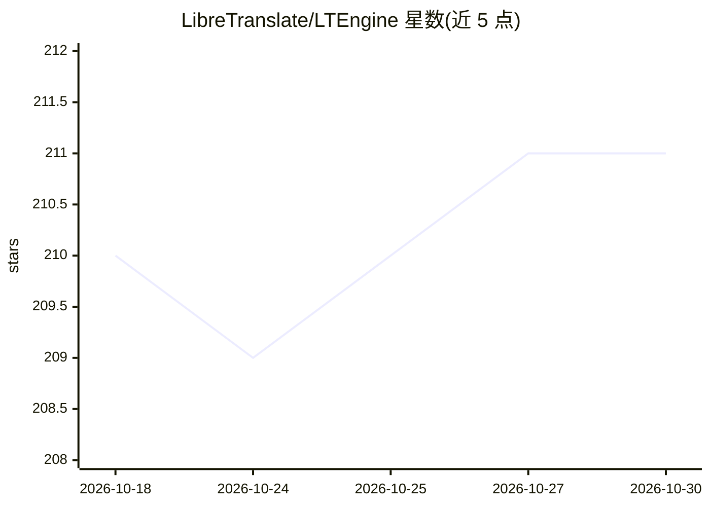

# LibreTranslate/LTEngine

⭐ 211 · Rust · AGPL-3.0 · 推送 2026-10-14 · [GitHub](https://github.com/LibreTranslate/LTEngine) · 组织维护

**本地 LLM 机器翻译 API 服务，兼容 LibreTranslate 接口**

用 Rust 编写、完全自托管的机器翻译 API，翻译能力由本地经 llama.cpp 运行的 LLM（Gemma3 系列 GGUF 模型）提供，接口兼容 LibreTranslate，支持翻译、语言自动检测，可通过 --model-file 加载任意 llama.cpp 支持的 GGUF 模型。可纯 CPU 运行，也支持 CUDA/Metal/Vulkan 加速；最大模型 gemma3-27b 需约 16G 内存与 18G 显存。需从源码用 cargo 编译，要求 Rust、clang、CMake 与 C++ 编译器。项目处于活跃开发阶段。

## 筛选速览

| 维度 | 判定 | 备注 |
|---|---|---|
| AI 角色 | `ai-native` | 本体是模型或模型工具 |
| 许可风险 | `viral` | AGPL-3.0 |
| 部署形态 | `None` |  |
| 模型依赖 | local-ok | 支持本地模型 |
| 硬件要求 | — | 无带数字的原话,不猜 |
| 安装摩擦 | `medium` | 含编译或系统依赖之一 |
| 成熟度 | `idea` | |

## 能力要点

- 翻译由本地 LLM 驱动，接口兼容 LibreTranslate
- 支持 CUDA/Metal/Vulkan 加速，也可纯 CPU 运行
- 支持加载任意 llama.cpp 兼容的 GGUF 模型
- 提供 Rust/Node.js/Python/Go 等十余种语言绑定

## 适用场景

- 自托管部署一个不依赖云服务的机器翻译 API
- 替换或对接现有 LibreTranslate 客户端获得 LLM 翻译质量
- 本地运行大模型翻译并按硬件选择模型规格

## 场景标签

 · 领域:机器翻译/NLP 服务

## 证据(README 行号)

> L3: Free and Open Source Local AI Machine Translation API, written in Rust, entirely self-hosted and compatible with Lib
> L7: The LLMs in LTEngine are much larger than the lightweight transformer models in LibreTranslate. Thus memory usage an
> L48: LTEngine supports any GGUF language model supported by llama.cpp. You can pass a path to load a custom .gguf model 

## 星数曲线

2026-10-18 210 → 2026-10-30 211（+1）

---
*卡片 v1 · prompt 1.4 · 生成 2026-10-22 · 置信度 high · 依据 README sha `1797e52c5a28` · [字段定义](../../DATASET.md)*
