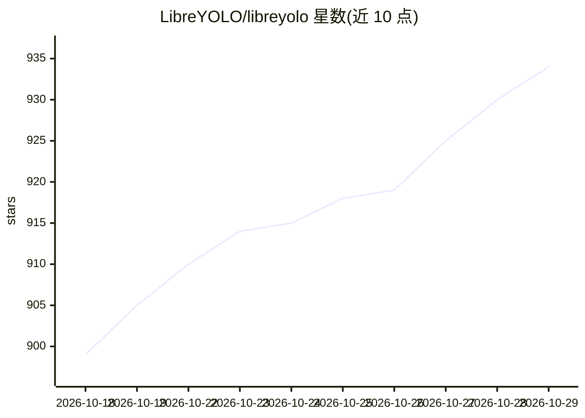

# LibreYOLO/libreyolo

⭐ 934 · Python · NOASSERTION · 推送 2026-10-28 · [GitHub](https://github.com/LibreYOLO/libreyolo) · [官网](https://www.libreyolo.com/) · 组织维护 · 中文 README

**MIT 许可的计算机视觉库：统一 API 跑检测/分割/姿态等二十余类任务**

MIT 许可的 Python 计算机视觉库，用一个三行 API 覆盖检测、实例/语义/全景分割、姿态估计、深度、OCR、边缘检测、图像修复、开放词汇与 VLM 等二十余类任务，收录 YOLOv9、RF-DETR、RT-DETR、SAM 系列等大量模型。读取常见 YOLO 格式数据集以兼容既有工作流，内置训练（多 GPU、LoRA、蒸馏、多种实验日志后端）、推理（摄像头/RTSP 流/YouTube/屏幕等来源）与导出（ONNX、TensorRT、OpenVINO、TFLite、NCNN 等十二种格式，含 Triton serving 与 DeepStream 配置生成）。经 pip 安装，重型模型族与导出后端以 extras 可选安装。

## 筛选速览

| 维度 | 判定 | 备注 |
|---|---|---|
| AI 角色 | `ai-native` | 本体是模型或模型工具 |
| 许可风险 | `none` | NOASSERTION |
| 部署形态 | `library` | 以包/库形式分发 |
| 模型依赖 | — | README 未给出锁定关系 |
| 硬件要求 | — | 无带数字的原话,不猜 |
| 安装摩擦 | `low` | 无编译、无系统依赖或容器化 |
| 成熟度 | — | 结构信号不足 |

## 能力要点

- 统一三行 API 支持检测/分割/姿态/深度/OCR 等二十余类任务
- 收录 YOLOv9、RF-DETR、RT-DETR、SAM 系列等大量模型
- 内置训练（多 GPU/LoRA/蒸馏）与十二种格式导出
- 推理来源支持摄像头、RTSP 流、视频、YouTube URL 与屏幕捕获

## 适用场景

- 对图像、视频或摄像头流做目标检测与实例分割
- 在自有的 YOLO 格式数据集上训练模型
- 导出 ONNX/TensorRT/TFLite 等格式部署到边缘设备
- 用统一 API 在不同视觉模型间切换与对比

## 场景标签

`目标检测` `图像视频处理` `OCR` `微调` · 领域:感知与多模态

## 证据(README 行号)

> L16: **An MIT-licensed computer vision library.** Detection, segmentation, pose,
> L75: LibreYOLO("LibreYOLO9t.pt")("street.jpg", save=True)             # detection

## 星数曲线

2026-10-18 899 → 2026-10-29 934（+35）

---
*卡片 v1 · prompt 1.4 · 生成 2026-10-21 · 置信度 high · 依据 README sha `657799d00fb3` · [字段定义](../../DATASET.md)*
