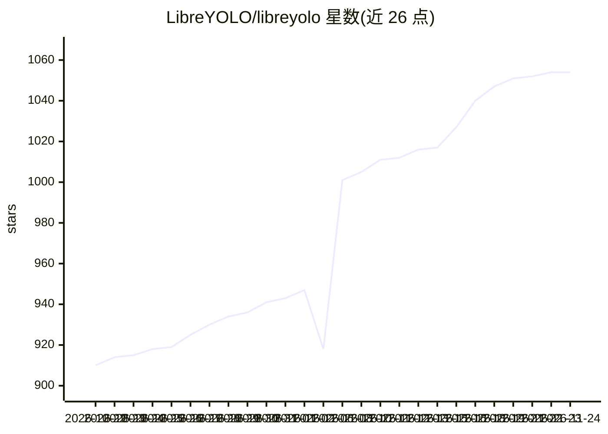

# LibreYOLO/libreyolo

⭐ 1,054 · Python · MIT · 推送 2026-11-22 · [GitHub](https://github.com/LibreYOLO/libreyolo) · [官网](https://www.libreyolo.com/) · 组织维护 · 中文 README

**MIT 许可的计算机视觉库：训练、推理与导出视觉模型**

MIT 许可的计算机视觉 Python 库，覆盖训练、推理与导出三类工作流。支持 23 个任务、151 个模型家族（检测、分割、姿态、深度、OCR、开放词汇、图像/3D 生成等），权重从 Hugging Face 下载（支持 HF_ENDPOINT 镜像变量）。推理源支持摄像头、RTSP、视频、屏幕等；导出支持 12 种格式及 Triton serving、DeepStream 配置生成。训练侧支持多 GPU、LoRA、蒸馏、混合精度等。通过 pip 安装，提供可选 extras 与 CLI。

## 筛选速览

| 维度 | 判定 | 备注 |
|---|---|---|
| AI 角色 | `ai-native` | 本体是模型或模型工具 |
| 许可风险 | `permissive` | MIT |
| 部署形态 | `library` | 以包/库形式分发 |
| 模型依赖 | local-ok | 支持本地模型 |
| 硬件要求 | — | 无带数字的原话,不猜 |
| 安装摩擦 | `low` | 无编译、无系统依赖或容器化 |
| 成熟度 | — | 结构信号不足 |

## 能力要点

- 23 任务 151 模型家族，统一 API 训练/推理/导出
- 12 种导出格式，含 Triton serving 与 DeepStream 配置生成
- 推理源支持摄像头、RTSP 流、屏幕捕获、YouTube URL 等
- 支持 HF_ENDPOINT 镜像以应对 Hugging Face 访问受限场景

## 适用场景

- 训练目标检测/分割模型并在边缘设备部署
- 从摄像头或 RTSP 流做实时检测推理
- 将模型导出为 ONNX/TensorRT/TFLite 等格式集成到生产环境

## 场景标签

`目标检测` `OCR` `微调` · 领域:感知与多模态

## 证据(README 行号)

> L3: LibreYOLO is an MIT licensed computer vision library to train, run, and export computer vision models.
> L143:   ROOT(["<big><big><b>LibreYOLO</b></big></big> <small>151 model families, 23 tasks</small>"])

## 星数曲线

2026-10-22 910 → 2026-11-24 1,054（+144）

---
*卡片 v1 · prompt 1.4 · 生成 2026-11-24 · 置信度 high · 依据 README sha `c1b8339fce60` · [字段定义](../../DATASET.md)*
