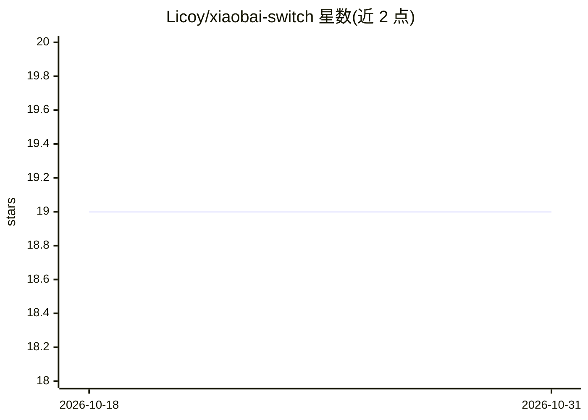

# Licoy/xiaobai-switch

⭐ 19 · Rust · 推送 2026-10-23 · [GitHub](https://github.com/Licoy/xiaobai-switch) · [官网](https://xiaobaiswitch.com) · 个人维护 · 中文 README

**给小白的 Claude Code/Codex/Pi 上游配置切换桌面应用**

跨平台桌面应用，以「上游站点」为中心管理 Claude Code、Codex、Pi 的上游配置：填写 Base URL 与 API Key，拉取或手输模型，一键写入目标 CLI 的配置。支持多线路测速切换、应用前自动备份与还原、xiaobaiswitch:// 链接导入站点。API Key 在应用内加密存储，但应用后会明文写入对应 CLI 配置文件。提供 macOS（Apple Silicon/Intel）与 Windows（x64/ARM64）安装包，macOS 包为 ad-hoc 签名需手动去除隔离属性。

## 筛选速览

| 维度 | 判定 | 备注 |
|---|---|---|
| AI 角色 | `ai-ecosystem` | LLM/agent 周边工具 |
| 许可风险 | `none` | — |
| 部署形态 | `None` |  |
| 模型依赖 | — | README 未给出锁定关系 |
| 硬件要求 | — | 无带数字的原话,不猜 |
| 安装摩擦 | `low` | 无编译、无系统依赖或容器化 |
| 成熟度 | — | 结构信号不足 |

## 能力要点

- 多上游站点管理：多线路、测速、一键切换
- 向 Claude Code / Codex / Pi 写入站点与模型配置，应用前自动备份
- xiaobaiswitch:// 链接一键导入站点（含 Codex 预设参数）
- API Key 应用内加密存储，托盘常驻、中英文界面

## 适用场景

- 在多个中转站点之间快速切换 Claude Code / Codex 的上游
- 从站点拉取模型并测试可用性后应用到 CLI
- 通过分享链接向他人分发站点配置

## 场景标签

 · 领域:AI 开发工具/配置管理

## 证据(README 行号)

> L9: 小白也能上手的，以站点驱动的 Claude Code / Codex / Pi 上游配置桌面应用。
> L17: - **应用中心**：分别为 Claude Code、Codex、Pi 选择站点、模型与目标选项后写入

## 星数曲线

2026-10-18 19 → 2026-10-31 19（+0）

---
*卡片 v1 · prompt 1.4 · 生成 2026-10-29 · 置信度 high · 依据 README sha `d430d73887ff` · [字段定义](../../DATASET.md)*
