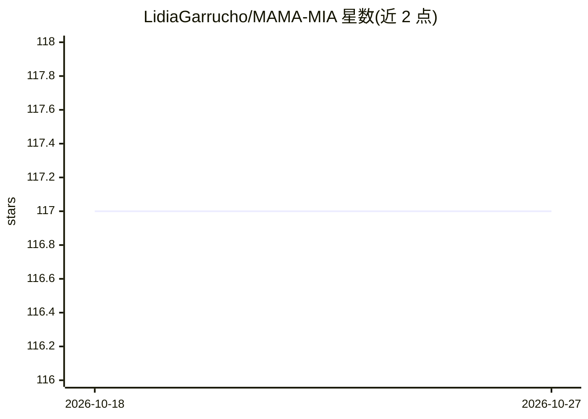

# LidiaGarrucho/MAMA-MIA

⭐ 117 · Jupyter Notebook · NOASSERTION · 推送 2026-09-23 · [GitHub](https://github.com/LidiaGarrucho/MAMA-MIA) · [官网](https://doi.org/10.7303/syn60868042) · 组织维护

**1,506 例多中心乳腺癌 DCE-MRI 公开数据集，含专家分割**

面向医学影像研究者的公开基准数据集：汇集 1,506 例多中心乳腺癌动态对比增强 MRI（DCE-MRI），附带专家肿瘤分割标注，图像来源于 TCIA 四个公开合集（ISPY1/2、Breast-MRI-NACT-Pilot、Duke）。通过 Synapse CLI/Python 或 XNAT 平台下载（需账号/token）。仓库另含在全部数据上训练的 nnUNet 预训练模型，提供 git clone、依赖安装、权重下载与 nnUNetv2_predict 推理流程，并附五折 Dice/IoU/HD95/MSD 指标。

## 筛选速览

| 维度 | 判定 | 备注 |
|---|---|---|
| AI 角色 | `ai-knowledge` | 知识聚合/清单类 |
| 许可风险 | `none` | NOASSERTION |
| 部署形态 | `None` |  |
| 模型依赖 | — | README 未给出锁定关系 |
| 硬件要求 | — | 无带数字的原话,不猜 |
| 安装摩擦 | `low` | 无编译、无系统依赖或容器化 |
| 成熟度 | — | 结构信号不足 |

## 能力要点

- 1,506 例多中心乳腺癌 DCE-MRI 数据，附专家肿瘤分割
- 提供全数据训练的 nnUNet 预训练分割模型与推理命令
- Synapse 主渠道下载，XNAT 作为替代访问途径
- 配套 MAMA-MIA Challenge（分割与治疗反应预测两任务）

## 适用场景

- 在多中心乳腺癌 MRI 上做肿瘤分割模型的训练与基准评测
- 用预训练 nnUNet 权重对自己的 DCE-MRI 做分割或微调
- 做放射组学特征提取、治疗反应与生存预测研究

## 场景标签

`目标检测` `模型评测` · 领域:评测与运维

## 证据(README 行号)

> L5: Welcome to the **MAMA-MIA** dataset repository! This dataset contains **1,506** cases of **breast cancer** dynamic c
> L31: - Classification, Detection and Segmentation of Breast Cancer in MRI using Deep Learning.

## 星数曲线

2026-10-18 117 → 2026-10-27 117（+0）

---
*卡片 v1 · prompt 1.4 · 生成 2026-10-23 · 置信度 high · 依据 README sha `2c3cca524593` · [字段定义](../../DATASET.md)*
