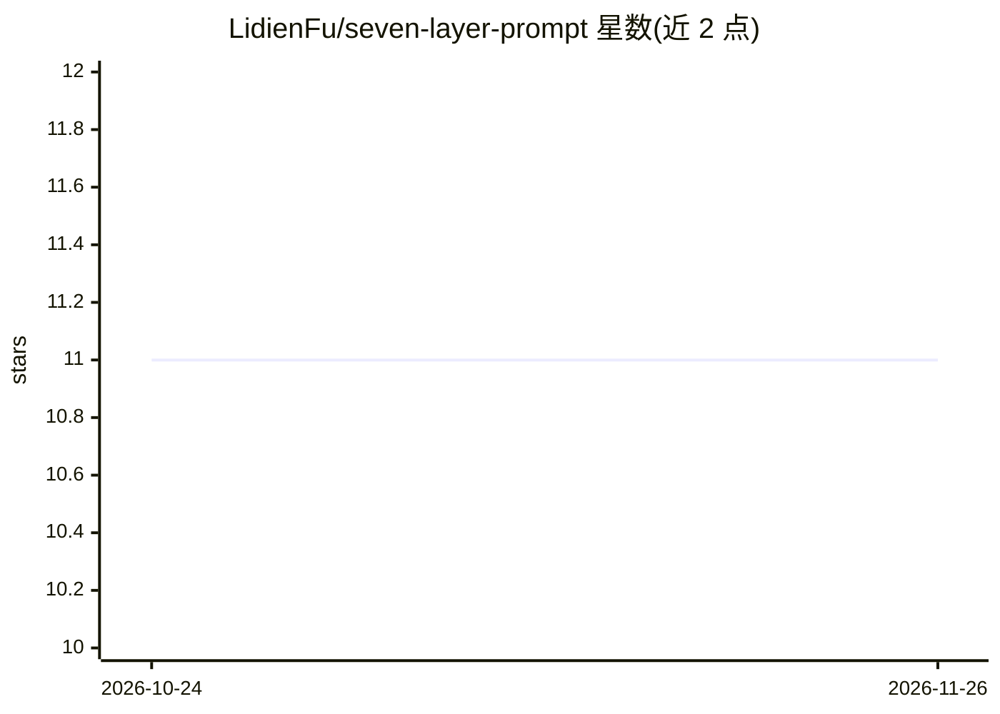

# LidienFu/seven-layer-prompt

⭐ 11 · Python · MIT · 推送 2026-06-25 · [GitHub](https://github.com/LidienFu/seven-layer-prompt) · 个人维护

**生产级 AI agent 系统提示词的七层结构脚手架**

面向生产 agent 系统提示词的结构模板：把提示词拆成 7 个命名层，每层标注 FIXED（跨客户共享）或 CONFIG（按客户配置），换客户只改 YAML 配置而非复制分叉整个提示词。安全层（拒绝规则、提示注入防护）在结构层面强制存在，参考实现不允许关闭注入防护层。附带 Python 参考组装器、守卫测试与两个示例客户配置。作者声明其为结构而非框架，无可安装运行时。

## 筛选速览

| 维度 | 判定 | 备注 |
|---|---|---|
| AI 角色 | `ai-ecosystem` | LLM/agent 周边工具 |
| 许可风险 | `permissive` | MIT |
| 部署形态 | `None` |  |
| 模型依赖 | — | README 未给出锁定关系 |
| 硬件要求 | — | 无带数字的原话,不猜 |
| 安装摩擦 | `low` | 无编译、无系统依赖或容器化 |
| 成熟度 | — | 结构信号不足 |

## 能力要点

- FIXED/CONFIG 分层：换客户只需改配置文件
- 提示注入防护为独立层且不可被配置移除
- 自带 Python 参考组装器，测试兼作规范
- 提供电商客服与诊所预约两个完整示例配置

## 适用场景

- 为多个客户/租户运行 agent 且需要统一维护核心提示词
- 治理已经膨胀到难以审查的系统提示词
- 为新 agent 设计系统提示词时套用安全层结构

## 场景标签

`提示工程` · 领域:Agent 开发

## 证据(README 行号)

> L5: **A 7-layer scaffold for production AI agent system prompts. Security-first. Multi-tenant by design.**
> L62: A small, framework-agnostic Python assembler with guard tests lives in `reference-impl/python/`. The tests double a

## 星数曲线

2026-10-24 11 → 2026-11-26 11（+0）

---
*卡片 v1 · prompt 1.4 · 生成 2026-11-19 · 置信度 high · 依据 README sha `19788c30a93e` · [字段定义](../../DATASET.md)*
