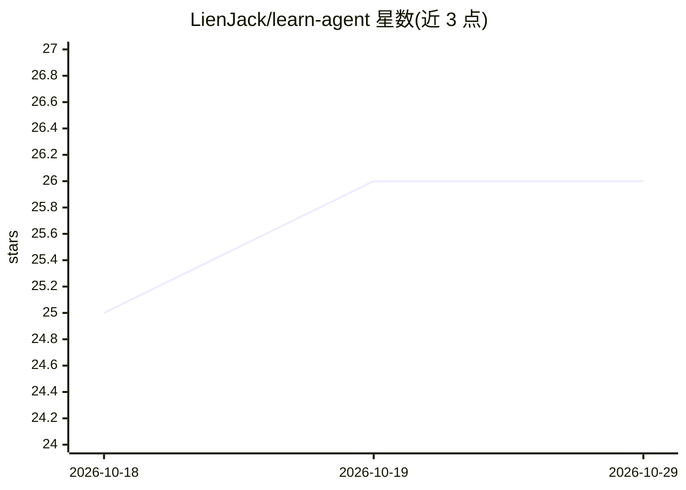

# LienJack/learn-agent

⭐ 26 · Mermaid · MIT · 推送 2026-07-11 · [GitHub](https://github.com/LienJack/learn-agent) · [官网](https://blog.lienjack.com) · 个人维护 · 中文 README

**工程师向技术博客知识库：系统学习 Agent、Claude Code 源码与后端基础**

基于 Astro 构建的中文多语言技术博客与知识库，内容覆盖 AI Agent（LLM/Prompt/RAG/工作流）、Claude Code 源码解析（架构、ReAct、Context、MCP、多 Agent 协作）、MySQL/PostgreSQL 与 Redis 核心机制、前端内容工程四个板块，以概念地图加源码拆解的方式组织文章。仓库本身即博客源码，附带给 Codex 使用的图片、翻译、发布 skill 集合。本地运行需 Node.js>=22.12.0 与 pnpm。

## 筛选速览

| 维度 | 判定 | 备注 |
|---|---|---|
| AI 角色 | `ai-knowledge` | 知识聚合/清单类 |
| 许可风险 | `permissive` | MIT |
| 部署形态 | `library` | 以包/库形式分发 |
| 模型依赖 | — | README 未给出锁定关系 |
| 硬件要求 | — | 无带数字的原话,不猜 |
| 安装摩擦 | `low` | 无编译、无系统依赖或容器化 |
| 成熟度 | — | 结构信号不足 |

## 能力要点

- AI Agent 概念地图：LLM、Prompt、RAG、Agent 工作流到 GraphRAG
- Claude Code 源码解析：ReAct、Context 管理、MCP、多 Agent 协作
- MySQL/PostgreSQL/Redis 核心机制与生产架构梳理
- 内置 Codex 图片、翻译、发布三组 skill 流程

## 适用场景

- 系统学习 AI Agent 与 Claude Code 的工程实现原理
- 补齐数据库与 Redis 的底层机制与调优知识
- 参考 Astro 多语言博客的内容工程实践

## 场景标签

`教程课程` · 领域:学习与行业

## 证据(README 行号)

> L9: `learn-agent` 是一个面向工程师的技术博客和知识库。它不只记录“某个概念是什么”，更关心一个系统为什么这样设计、一次模型调用背后发生了什么、一个工具链如何拆成可理解的工程模块。
> L13: - AI Agent：从 LLM、Prompt、RAG 到 Agent 工作流，建立完整的概念地图。
> L14: - Claude Code 源码解析：拆解架构、ReAct、Prompt、Context 管理、Tools、MCP、Skill、多 Agent 协作和 Plan。

## 星数曲线

2026-10-18 25 → 2026-10-29 26（+1）

---
*卡片 v1 · prompt 1.4 · 生成 2026-10-26 · 置信度 mid · 依据 README sha `795784b51d81` · [字段定义](../../DATASET.md)*
