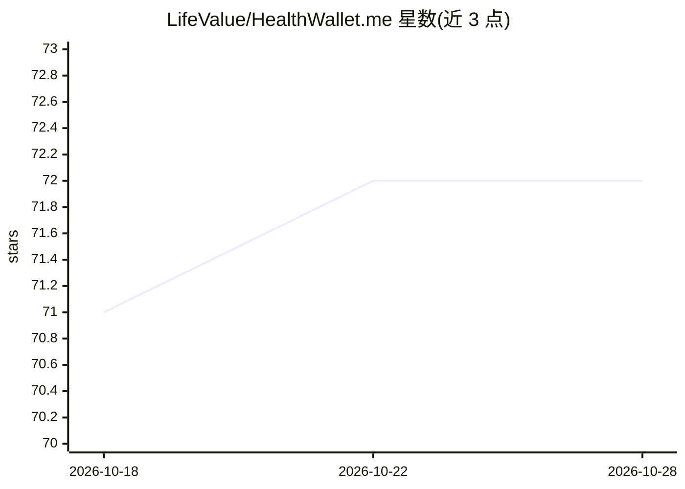

# LifeValue/HealthWallet.me

⭐ 72 · Dart · GPL-3.0 · 推送 2026-10-19 · [GitHub](https://github.com/LifeValue/HealthWallet.me) · [官网](https://healthwallet.me) · 组织维护

**患者自控的健康档案应用：聚合 52K+ 机构数据并本地 AI 扫描**

面向患者的开源健康档案管理应用（Flutter），通过 FHIR R4 API 与自托管的 FastenHealth 后端连接美国 52,000+ 医疗机构，将病历、用药、检验等数据聚合到手机，支持离线访问。内置 on-device AI：基于 llama.cpp 在手机本地运行量化模型（Qwen3-VL-2B / MedGemma-4B），拍摄纸质医疗文档并提取为结构化 FHIR 记录，iOS 用 Metal 加速、Android 走 CPU。另提供跨平台近场分享、IPS 导出与钱包急救卡。GPL v3，App Store / Google Play 分发，后端需 Docker 自建。

## 筛选速览

| 维度 | 判定 | 备注 |
|---|---|---|
| AI 角色 | `ai-enhanced` | 去掉 AI 部分产品仍成立 |
| 许可风险 | `viral` | GPL-3.0 |
| 部署形态 | `self-host` | docker 或自建部署 |
| 模型依赖 | — | README 未给出锁定关系 |
| 硬件要求 | — | 无带数字的原话,不猜 |
| 安装摩擦 | `low` | 无编译、无系统依赖或容器化 |
| 成熟度 | — | 结构信号不足 |

## 能力要点

- 本地 LLM（llama.cpp）扫描纸质文档并生成结构化 FHIR 记录，数据不离设备
- 经 FHIR R4 连接 52,000+ 美国医疗机构（自托管 FastenHealth 后端）
- 离线优先，本地 SQLite 存储，无强制云依赖
- iOS/Android 跨平台近场分享（接收方只读、阻止截图）与 IPS 出行摘要导出

## 适用场景

- 把多家医院/诊所的病历集中到一个手机应用统一查看
- 拍摄纸质检查单/处方，让本地 AI 提取成结构化档案
- 出国或急诊时出示国际患者摘要（IPS）或钱包急救卡

## 场景标签

`文档解析` `知识库管理` · 领域:知识与检索

## 证据(README 行号)

> L35: - **On-device AI** — Scan paper documents and the built-in LLM extracts structured FHIR resources locally. No cloud
> L46: |**AI Scan**|Photograph or import medical documents; the on-device LLM extracts patient info, encounters, medicatio

## 星数曲线

2026-10-18 71 → 2026-10-28 72（+1）

---
*卡片 v1 · prompt 1.4 · 生成 2026-10-24 · 置信度 high · 依据 README sha `d1708b34b1a3` · [字段定义](../../DATASET.md)*
