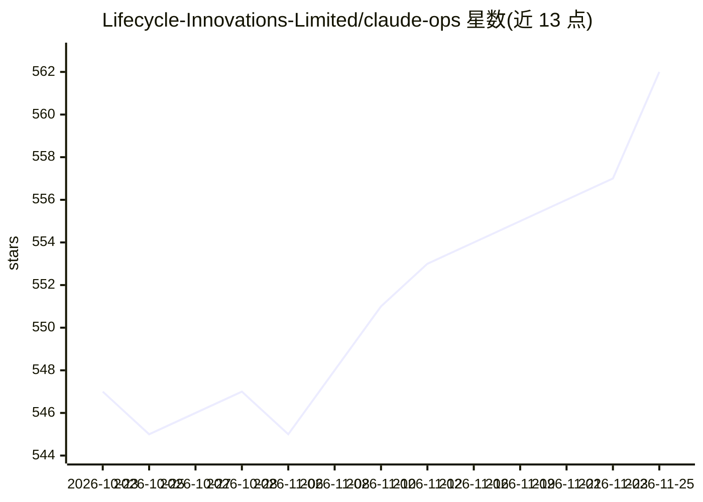

# Lifecycle-Innovations-Limited/claude-ops

⭐ 562 · Shell · MIT · 推送 2026-11-23 · [GitHub](https://github.com/Lifecycle-Innovations-Limited/claude-ops) · [官网](https://github.com/Lifecycle-Innovations-Limited/claude-ops/wiki) · 组织维护

**面向 Claude Code 用户的商业运营插件：收件箱、营收、运维一站式**

一个 Claude Code 插件（含 Hermes/Grok/Codex 等多 CLI 安装器），提供 70 个 /ops 技能与专家 agent：晨间简报仪表盘、统一收件箱（WhatsApp/Email/Slack/Telegram）、自主 PR 合并与构建失败自动修复、AWS/数据狗监控、营收快照、Shopify 电商与 Klaviyo/Meta/GA4 营销、语音通话表面（Twilio/Bland/ElevenLabs/Zoom）。后台 launchd 守护进程预热数据；外发消息走逐条审批门；含安全钩子与预算上限。

## 筛选速览

| 维度 | 判定 | 备注 |
|---|---|---|
| AI 角色 | `ai-ecosystem` | LLM/agent 周边工具 |
| 许可风险 | `permissive` | MIT |
| 部署形态 | `library` | 以包/库形式分发 |
| 模型依赖 | — | README 未给出锁定关系 |
| 硬件要求 | — | 无带数字的原话,不猜 |
| 安装摩擦 | `low` | 无编译、无系统依赖或容器化 |
| 成熟度 | — | 结构信号不足 |

## 能力要点

- 70 个 /ops 技能 + 专家 agent，覆盖运维/营收/电商/营销/语音
- 统一收件箱聚合 WhatsApp/Email/Slack/Telegram 等渠道
- 自主 PR 合并与构建失败自动修复（预算上限+单飞锁+内容哈希去重）
- 跨 CLI 安装器镜像技能到 Claude Code/Codex/Gemini/Cursor 等布局

## 适用场景

- 每天早晨一条命令获取业务与基础设施状态简报
- 由 agent 自主合并 PR 并修复构建失败
- 在一个界面处理多渠道收件箱与客户关系
- 查询 Stripe/RevenueCat 营收与 Shopify 订单运营

## 场景标签

`编码 Agent` `工作流自动化` `AI 助手` · 领域:效率与自动化

## 证据(README 行号)

> L7: Claude Code Plugin
> L24: Turn Claude Code into a complete business operating system — infrastructure health, CI/CD status, unified inbox, op
> L109: All 70 skills, grouped by category:

## 星数曲线

2026-10-23 547 → 2026-11-25 562（+15）

---
*卡片 v1 · prompt 1.4 · 生成 2026-11-25 · 置信度 high · 依据 README sha `8350d8a9e836` · [字段定义](../../DATASET.md)*
