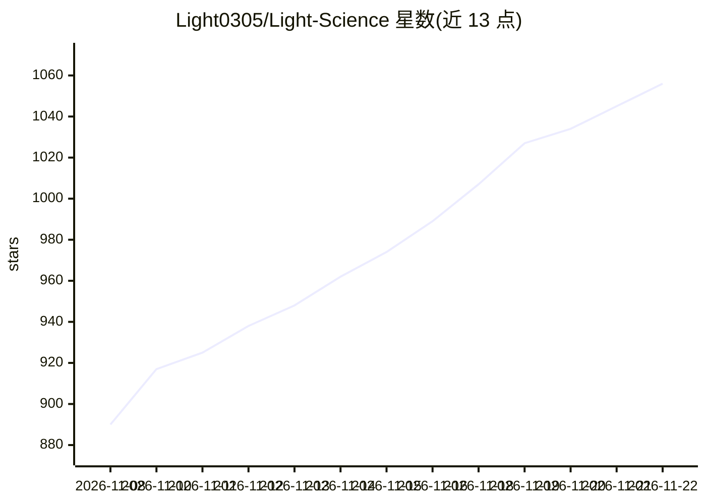

# Light0305/Light-Science

⭐ 1,056 · Python · MIT · 推送 2026-11-08 · [GitHub](https://github.com/Light0305/Light-Science) · [官网](https://lightchuan.xyz/) · 个人维护 · 中文 README

**面向 AI agent 的科研工作流技能包（19 个技能）**

原名 Light-skills，是供 AI agent（如 Claude Code 类框架）使用的科研技能包：覆盖文献检索与证据综合、选题、实验设计、计算实验、分析、期刊选择、LaTeX 写作、图表与机制图、投稿前评审、专利与软著材料准备等环节。项目记忆（light-memory）记录决策依据与约束，light-leader 协调技能调度与断点恢复。技能指令以中文编写、部分默认中文回复；通过 npx skills CLI 或让 agent 自行安装。

## 筛选速览

| 维度 | 判定 | 备注 |
|---|---|---|
| AI 角色 | `ai-ecosystem` | LLM/agent 周边工具 |
| 许可风险 | `permissive` | MIT |
| 部署形态 | `library` | 以包/库形式分发 |
| 模型依赖 | — | README 未给出锁定关系 |
| 硬件要求 | — | 无带数字的原话,不猜 |
| 安装摩擦 | `low` | 无编译、无系统依赖或容器化 |
| 成熟度 | — | 结构信号不足 |

## 能力要点

- 15 个主技能加 4 个 Diagram 专项技能，覆盖文献到投稿全流程
- 项目记忆记录决策来源，leader 技能负责协调与断点恢复
- 图表技能支持 Python/R 科学图与多面板图
- 机制图可经 Illustrator/PowerPoint/Visio 三种路线生成可编辑原生文件

## 适用场景

- 让 AI agent 端到端推进一篇论文的科研流程
- 从已有论文、数据集或审稿意见继续特定阶段
- 生成论文数据图与方法机制图并保留可编辑文件

## 场景标签

`科研工具` `AI 写作` · 领域:内容生成

## 证据(README 行号)

> L15: **Light-Science** (formerly Light-skills) is a research skills pack for AI agents. It connects literature, ideation
> L37: npx.cmd skills@latest add Light0305/Light-Science

## 星数曲线

2026-11-08 890 → 2026-11-22 1,056（+166）

---
*卡片 v1 · prompt 1.4 · 生成 2026-11-17 · 置信度 high · 依据 README sha `34496ca578a1` · [字段定义](../../DATASET.md)*
