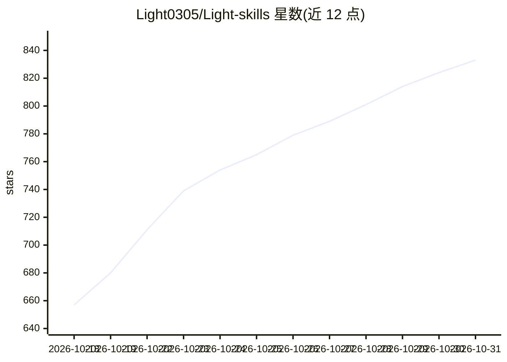

# Light0305/Light-skills

⭐ 833 · Python · MIT · 推送 2026-07-06 · [GitHub](https://github.com/Light0305/Light-skills) · [官网](https://github.com/Light0305/Light-skills#readme) · 个人维护 · 中文 README

**面向科研与竞赛的 AI agent 技能包（23 个技能）**

一套公开、领域无关的 AI 技能包（SKILL.md 格式，共 23 个技能），安装到 Claude Code、Codex、OpenCode 三类 agent 环境中使用，通过 bootstrap_agent_skills.py 脚本完成安装与检查。技能覆盖从选题查新、文献检索、研究设计、数据实验、论文写作、引用核查、LaTeX 排版到专利/软著材料的科研全流程，附七阶段主线流程。图表要求 Python/R 程序化生成可复现，LaTeX 环境缺失时标记 UNAVAILABLE；依赖 Git、Python 3.10+，可选 MiKTeX 与 R/ggplot2。

## 筛选速览

| 维度 | 判定 | 备注 |
|---|---|---|
| AI 角色 | `ai-ecosystem` | LLM/agent 周边工具 |
| 许可风险 | `permissive` | MIT |
| 部署形态 | `None` |  |
| 模型依赖 | — | README 未给出锁定关系 |
| 硬件要求 | — | 无带数字的原话,不猜 |
| 安装摩擦 | `low` | 无编译、无系统依赖或容器化 |
| 成熟度 | — | 结构信号不足 |

## 能力要点

- 23 个技能覆盖选题到投稿转化的七阶段科研流程
- 兼容 Claude Code / Codex / OpenCode 三类 agent 环境，脚本化安装
- 引用真实性四门核查、DOI/链接验证与未核查声明标注
- 论文图用 Python/R 程序化生成，色盲安全与视觉诚实检查

## 适用场景

- 把一个研究方向推进到可投稿的英文论文
- 让 agent 批判研究 idea 的创新性并做文献查新
- 核查论文引用真实性与跨材料一致性
- 整理专利交底书或软著申请材料

## 场景标签

`科研工具` · 领域:学习与行业

## 证据(README 行号)

> L19: Light Skills 是一套公开、通用、领域无关的 AI skill 包，用来把一个研究或创新项目从“模糊想法”推进到“可检查的交付物”。
> L57: python scripts\bootstrap_agent_skills.py --targets agents --mode auto --force

## 星数曲线

2026-10-18 657 → 2026-10-31 833（+176）

---
*卡片 v1 · prompt 1.4 · 生成 2026-10-21 · 置信度 high · 依据 README sha `05a6808a5b96` · [字段定义](../../DATASET.md)*
