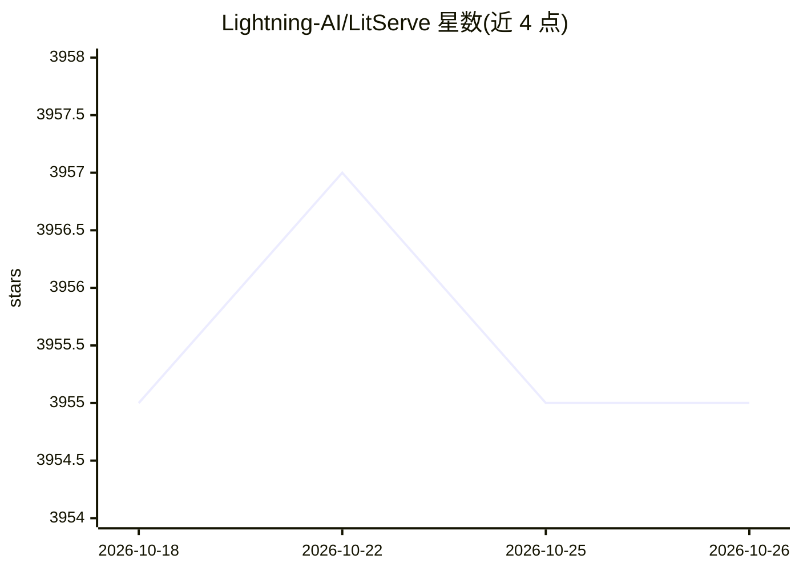

# Lightning-AI/LitServe

⭐ 3,955 · Python · Apache-2.0 · 推送 2026-10-20 · [GitHub](https://github.com/Lightning-AI/LitServe) · [官网](https://lightning.ai/litserve?utm_source=litserve_readme&utm_medium=referral&utm_campaign=litserve_readme) · 组织维护

**用纯 Python 构建自定义 AI 推理服务器的轻量框架**

面向需要自定义推理逻辑的开发者的 Python 服务框架：通过 LitAPI 类定义模型加载、批处理、路由与输出，LitServe 负责并发、性能、扩展与部署，可服务模型、Agent、RAG 或多模型流水线。基于 FastAPI 构建，支持多 GPU 自动扩缩容、流式输出、OpenAI 兼容、MCP server。可本地运行、自托管或一键部署到 Lightning Cloud。注意其自称并非开箱即用的 vLLM/Ollama 替代品，而是提供更低层的构建灵活度。

## 筛选速览

| 维度 | 判定 | 备注 |
|---|---|---|
| AI 角色 | `ai-ecosystem` | LLM/agent 周边工具 |
| 许可风险 | `permissive` | Apache-2.0 |
| 部署形态 | `library` | 以包/库形式分发 |
| 模型依赖 | local-ok | 支持本地模型 |
| 硬件要求 | — | 无带数字的原话,不猜 |
| 安装摩擦 | `medium` | 含编译或系统依赖之一 |
| 成熟度 | — | 结构信号不足 |

## 能力要点

- LitAPI 定义推理逻辑：模型加载、批处理、路由、流式全可控
- 支持 PyTorch/JAX/TF 等模型，可组合 vLLM 等引擎
- 多 GPU 自动扩缩容、批处理与流式输出
- 自托管或通过 lightning deploy 一键部署到 Lightning Cloud

## 适用场景

- 为自训模型或非标准流水线搭建自定义推理 API
- 构建 Agent、RAG 或多模型组合系统的服务端
- 需要自定义批处理/缓存逻辑的 LLM 服务，替代通用推理服务器的固定抽象

## 场景标签

`推理引擎` · 领域:训练与推理

## 证据(README 行号)

> L41: Most serving tools (vLLM, etc..) are built for a single model type and enforce rigid abstractions. They work well u
> L105: - **Deploy any pipeline or model**: Agents, pipelines, RAG, chatbots, image models, video, speech, text, etc...
> L110: - **FastAPI for AI:** Built on FastAPI but optimized for AI - 2× faster with AI-specific multi-worker handling (mo

## 星数曲线

2026-10-18 3,955 → 2026-10-26 3,955（+0）

---
*卡片 v1 · prompt 1.4 · 生成 2026-10-21 · 置信度 high · 依据 README sha `f2ee719ea724` · [字段定义](../../DATASET.md)*
