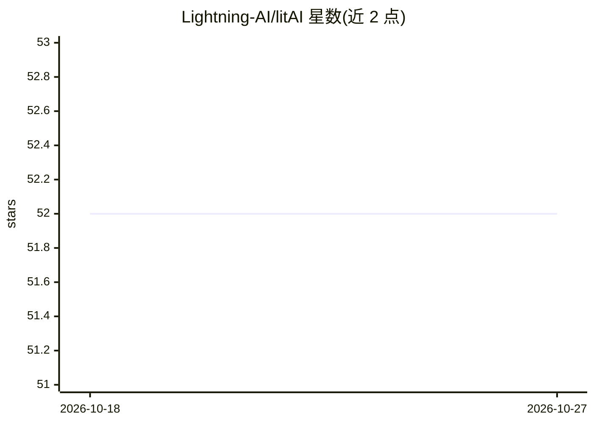

# Lightning-AI/litAI

⭐ 52 · Python · Apache-2.0 · 推送 2026-06-22 · [GitHub](https://github.com/Lightning-AI/litAI) · [官网](https://lightning.ai/docs/litai/home) · 组织维护

**Lightning AI 出品的 LLM 路由器与极简 Agent 框架（纯 Python）**

由 Lightning AI 维护的 Python 库，将 LLM 路由与最小化 agent 框架合一：通过统一的 LLM 类调用 20+ 公共模型（OpenAI 格式），并自动处理重试、故障回退、模型切换、统一计费、用量监控与日志。提供 .chat()/.if_()/.classify() 等入口、@tool 与 LitTool 工具机制、流式输出、async 并发与多轮会话记忆；也可通过 https://lightning.ai/api/v1 端点复用现有 OpenAI SDK。计费基于 Lightning AI credits（含 15 免费额度），支持自带 API key，企业功能含 SOC2/HIPAA 合规与私有/本地部署。

## 筛选速览

| 维度 | 判定 | 备注 |
|---|---|---|
| AI 角色 | `ai-ecosystem` | LLM/agent 周边工具 |
| 许可风险 | `permissive` | Apache-2.0 |
| 部署形态 | `library` | 以包/库形式分发 |
| 模型依赖 | — | README 未给出锁定关系 |
| 硬件要求 | — | 无带数字的原话,不猜 |
| 安装摩擦 | `low` | 无编译、无系统依赖或容器化 |
| 成熟度 | — | 结构信号不足 |

## 能力要点

- 统一 LLM 接口调用 20+ 模型，自动重试与故障回退到其他模型
- @tool 装饰器与 LitTool 两种工具机制，支持自动或手动工具调用
- 支持流式输出、async 并发、多轮会话记忆与按调用切换模型
- 兼容 OpenAI SDK 端点，用量与计费在 Lightning AI 仪表盘统一管理

## 适用场景

- 在纯 Python 中构建带工具调用的 agent 与 AI 应用
- 统一接入多家模型 API 并获得重试、回退与计费管理
- 用便宜与昂贵模型混合处理同一会话以控制成本

## 场景标签

`Agent 框架` `模型网关` · 领域:Agent 开发

## 证据(README 行号)

> L1: LLM router and minimal agent framework in one.
> L9: LitAI is an LLM router (OpenAI format) and minimal agent framework. Chat with any model (ChatGPT, Anthropic, etc) in
> L141: For those who already have their own SDK to call LLMs (like the OpenAI sdk), you can still use LitAI via the `http

## 星数曲线

2026-10-18 52 → 2026-10-27 52（+0）

---
*卡片 v1 · prompt 1.4 · 生成 2026-10-24 · 置信度 high · 依据 README sha `90679fa86d6d` · [字段定义](../../DATASET.md)*
