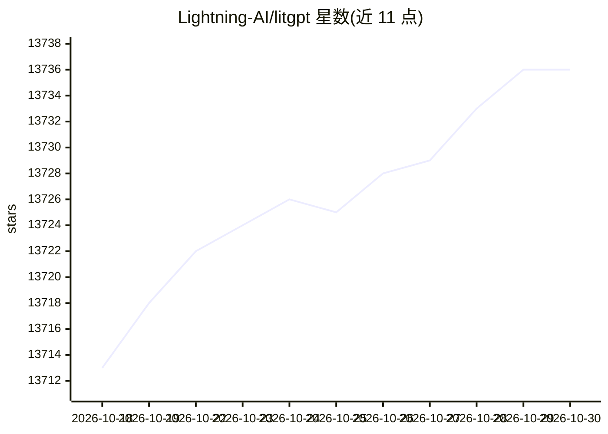

# Lightning-AI/litgpt

⭐ 13,736 · Python · Apache-2.0 · 推送 2026-10-28 · [GitHub](https://github.com/Lightning-AI/litgpt) · [官网](https://lightning.ai) · 组织维护

**给开发者用的 LLM 预训练/微调/部署全流程库**

以从零实现方式提供 20+ 开源 LLM（Llama、Qwen、Phi、Gemma、Mistral 等）的 PyTorch 库，通过统一 CLI 提供下载、chat、finetune、pretrain、continued pretraining、evaluate、serve 等工作流，并附 YAML 训练配置。支持 LoRA/QLoRA/Adapter 等参数高效微调、Flash Attention、FSDP 多卡与 TPU、4/8/16 位量化与权重格式导出；模型下载可能需要额外访问令牌。Apache 2.0 许可，pip 安装或从源码运行，由 Lightning AI 维护。

## 筛选速览

| 维度 | 判定 | 备注 |
|---|---|---|
| AI 角色 | `ai-ecosystem` | LLM/agent 周边工具 |
| 许可风险 | `permissive` | Apache-2.0 |
| 部署形态 | `library` | 以包/库形式分发 |
| 模型依赖 | — | README 未给出锁定关系 |
| 硬件要求 | — | 无带数字的原话,不猜 |
| 安装摩擦 | `low` | 无编译、无系统依赖或容器化 |
| 成熟度 | — | 结构信号不足 |

## 动量与使用信号

- 维护:`active` — 距上次 push 5.1 天,年发版 2,133 位贡献者
- 涨星:近 1 天 **+3**(自 20261016 起算)

## 能力要点

- 统一 CLI 覆盖下载/chat/finetune/pretrain/evaluate/serve 工作流
- 支持 LoRA、QLoRA、Adapter 与 Adapter v2 参数高效微调
- Flash Attention v2、FSDP 多 GPU、TPU/XLA 支持
- 4-bit/8-bit 量化降低显存需求

## 适用场景

- 在自己的数据上微调开源 LLM
- 从头预训练并试验最新研究想法
- 把模型部署为推理 API 集成到应用中
- 在 MMLU、TruthfulQA 等基准上评估模型

## 场景标签

`微调` `模型量化` `模型训练` `模型评测` · 领域:评测与运维

## 证据(README 行号)

> L3: **20+ high-performance LLMs with recipes to pretrain, finetune, and deploy at scale.**
> L181: # litgpt [action] [model]
> L345: ✅ State-of-the-art optimizations: Flash Attention v2, multi-GPU support via fully-sharded data parallelism, option

## 星数曲线

2026-10-18 13,713 → 2026-10-30 13,736（+23）

---
*卡片 v1 · prompt 1.4 · 生成 2026-10-18 · 置信度 high · 依据 README sha `9b14745e33e1` · [字段定义](../../DATASET.md)*
