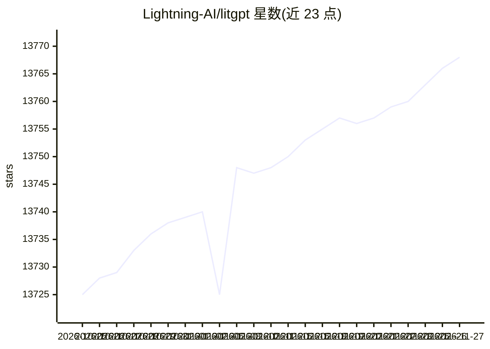

# Lightning-AI/litgpt

⭐ 13,768 · Python · Apache-2.0 · 推送 2026-11-10 · [GitHub](https://github.com/Lightning-AI/litgpt) · [官网](https://lightning.ai) · 组织维护

**为开发者提供 20+ LLM 的从零实现与预训练、微调、部署配方**

LitGPT 以从零实现、无抽象层的方式提供 20+ 开源 LLM（Llama、Qwen、Phi、Mistral、Gemma 等）的实现，配套 CLI 与 YAML 配方覆盖 pretrain、finetune、continued pretraining、evaluate、serve、chat 等工作流。内置 Flash Attention v2、FSDP 多 GPU、TPU/XLA 支持、FP16/BF16/4-bit/8-bit 量化及 LoRA/QLoRA/Adapter 等参数高效微调方法，支持 1-1000+ GPU/TPU 规模训练，Apache 2.0 许可，可通过 PyPI 安装或从源码运行。

## 筛选速览

| 维度 | 判定 | 备注 |
|---|---|---|
| AI 角色 | `ai-ecosystem` | LLM/agent 周边工具 |
| 许可风险 | `permissive` | Apache-2.0 |
| 部署形态 | `library` | 以包/库形式分发 |
| 模型依赖 | — | README 未给出锁定关系 |
| 硬件要求 | — | 无带数字的原话,不猜 |
| 安装摩擦 | `low` | 无编译、无系统依赖或容器化 |
| 成熟度 | — | 结构信号不足 |

## 动量与使用信号

- 维护:`active` — 距上次 push 5.1 天,年发版 2,133 位贡献者
- 涨星:近 1 天 **+3**(自 20261016 起算)

## 能力要点

- 20+ LLM 从零实现，单文件结构、无抽象层
- CLI 一条命令完成 serve/finetune/pretrain/chat/evaluate
- LoRA、QLoRA、Adapter 等参数高效微调与 4/8-bit 量化
- YAML 训练配方与可自定义的全部训练参数配置

## 适用场景

- 在自己的数据上微调或继续预训练开源 LLM
- 通过 litgpt serve 将模型部署为可被应用调用的 Web API
- 用 MMLU、TruthfulQA 等任务评估模型表现
- 阅读无抽象的模型实现代码做研究实验

## 场景标签

`微调` `模型量化` `模型训练` · 领域:训练与推理

## 证据(README 行号)

> L41: # Finetune, pretrain, and inference LLMs Lightning fast ⚡⚡
> L176: Use the command line interface to run advanced workflows such as pretraining or finetuning on your own data.
> L183: litgpt  serve     meta-llama/Llama-3.2-3B-Instruct

## 星数曲线

2026-10-25 13,725 → 2026-11-27 13,768（+43）

---
*卡片 v1 · prompt 1.4 · 生成 2026-11-22 · 置信度 high · 依据 README sha `61e75ed84c65` · [字段定义](../../DATASET.md)*
