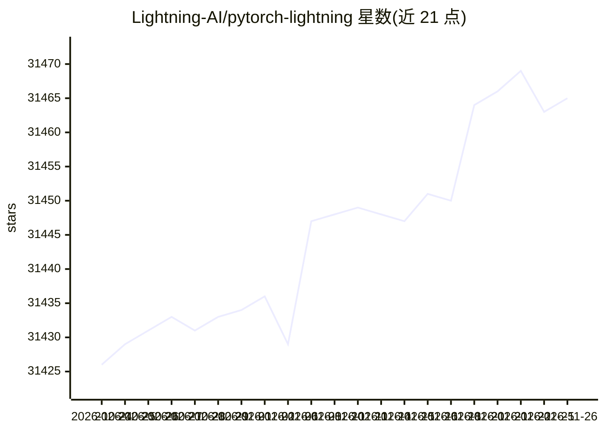

# Lightning-AI/pytorch-lightning

⭐ 31,465 · Python · Apache-2.0 · 推送 2026-11-25 · [GitHub](https://github.com/Lightning-AI/pytorch-lightning) · [官网](https://lightning.ai/pytorch-lightning/?utm_source=ptl_readme&utm_medium=referral&utm_campaign=ptl_readme) · 组织维护

**组织 PyTorch 训练代码的深度学习框架，免改代码扩展到多 GPU**

PyTorch Lightning 将 PyTorch 训练中的工程代码（反向传播、混合精度、多 GPU、分布式）组织为可复用结构，用户保留模型逻辑控制权；提供 PyTorch Lightning（Trainer 封装）与 Lightning Fabric（细粒度控制训练循环与扩展策略）两个核心包。支持 DDP/FSDP/DeepSpeed、16-bit 精度、断点保存、早停、实验管理，可导出 TorchScript/ONNX。通过 pip/conda 安装，跨 Linux/macOS/Windows 与多版本 PyTorch 测试。

## 筛选速览

| 维度 | 判定 | 备注 |
|---|---|---|
| AI 角色 | `ai-ecosystem` | LLM/agent 周边工具 |
| 许可风险 | `permissive` | Apache-2.0 |
| 部署形态 | `library` | 以包/库形式分发 |
| 模型依赖 | — | README 未给出锁定关系 |
| 硬件要求 | — | 无带数字的原话,不猜 |
| 安装摩擦 | `medium` | 含编译或系统依赖之一 |
| 成熟度 | — | 结构信号不足 |

## 动量与使用信号

- 维护:`active` — 距上次 push 5.9 天,年发版 6,431 位贡献者
- 涨星:近 1 天 **+2**(自 20261016 起算)
- 安装:pypi 包 `lightning` 月下载 3,753,872

## 能力要点

- Trainer 参数切换 CPU/GPU/TPU/多节点训练，无需改动核心代码
- 内置 DDP、FSDP、DeepSpeed 分布式策略与混合精度
- 支持导出 TorchScript (JIT) 与 ONNX 用于生产部署
- 40+ 高级特性：早停、检查点、实验管理器等

## 适用场景

- 研究项目需要在单卡与多 GPU/多节点之间切换训练
- 预训练或微调 LLM、扩散模型、Transformer 等大规模模型
- 减少 PyTorch 工程样板代码以提升实验可复现性
- 将训练好的模型导出为 TorchScript/ONNX 部署

## 场景标签

`模型训练` · 领域:训练与推理

## 证据(README 行号)

> L3: **The deep learning framework to pretrain and finetune AI models.**
> L33: Training models in plain PyTorch requires writing and maintaining a lot of repetitive engineering code. Handling ba
> L44: PyTorch Lightning: Train and deploy PyTorch at scale.

## 星数曲线

2026-10-24 31,426 → 2026-11-26 31,465（+39）

---
*卡片 v1 · prompt 1.4 · 生成 2026-11-25 · 置信度 high · 依据 README sha `f3a5cc308c21` · [字段定义](../../DATASET.md)*
