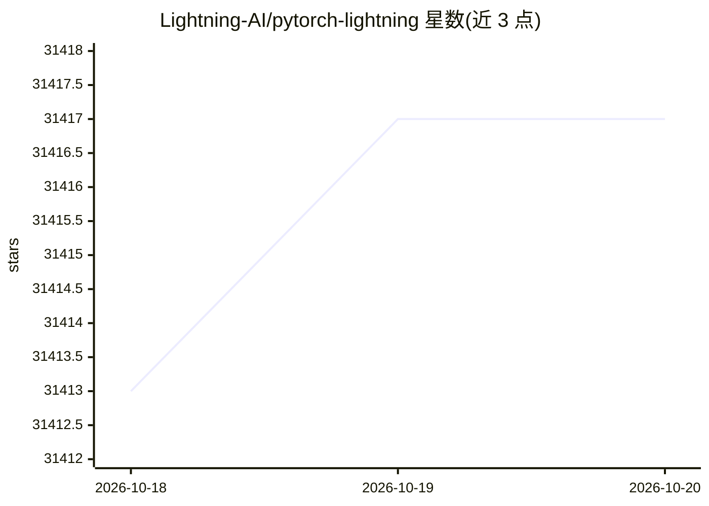

# Lightning-AI/pytorch-lightning

⭐ 31,417 · Python · Apache-2.0 · 推送 2026-10-12 · [GitHub](https://github.com/Lightning-AI/pytorch-lightning) · [官网](https://lightning.ai/pytorch-lightning/?utm_source=ptl_readme&utm_medium=referral&utm_campaign=ptl_readme) · 组织维护

**为深度学习开发者提供的 PyTorch 训练框架，自动化工程代码**

组织 PyTorch 代码的深度学习框架，将反向传播、混合精度、多 GPU 与分布式训练等工程代码自动化，用户保留模型逻辑控制。提供两个核心包：PyTorch Lightning（Trainer 抽象）与 Lightning Fabric（专家级控制）。通过 pip/conda 安装，支持从 CPU 到多节点 GPU/TPU 运行，提供 40+ 高级特性如早停、检查点、ONNX/TorchScript 导出，并维护多平台 CI 测试矩阵。

## 筛选速览

| 维度 | 判定 | 备注 |
|---|---|---|
| AI 角色 | `ai-ecosystem` | LLM/agent 周边工具 |
| 许可风险 | `permissive` | Apache-2.0 |
| 部署形态 | `library` | 以包/库形式分发 |
| 模型依赖 | — | README 未给出锁定关系 |
| 硬件要求 | — | 无带数字的原话,不猜 |
| 安装摩擦 | `medium` | 含编译或系统依赖之一 |
| 成熟度 | — | 结构信号不足 |

## 动量与使用信号

- 维护:`active` — 距上次 push 5.9 天,年发版 6,431 位贡献者
- 涨星:近 1 天 **+2**(自 20261016 起算)
- 安装:pypi 包 `lightning` 月下载 3,753,872

## 能力要点

- Trainer 接口无需改代码即可切换 CPU/GPU/TPU、多 GPU 与多节点训练
- Fabric 提供对训练循环与扩展策略（DDP/FSDP/DeepSpeed）的专家级控制
- 支持 TorchScript 与 ONNX 导出用于生产部署
- 早停、检查点、实验管理等 40+ 高级特性

## 适用场景

- 在多个 GPU 节点上预训练或微调大模型
- 将现有 PyTorch 代码重构为可扩展的训练脚本
- 复现学术论文中的分类、分割、摘要等训练实验

## 场景标签

`模型训练` `微调` · 领域:训练与推理

## 证据(README 行号)

> L3: **The deep learning framework to pretrain and finetune AI models.**
> L34: Training models in plain PyTorch requires writing and maintaining a lot of repetitive engineering code. Handling ba
> L45: PyTorch Lightning: Train and deploy PyTorch at scale.
> L264:  Use state-of-the-art distributed training strategies (DDP, FSDP, DeepSpeed) and mixed precision out of the box

## 星数曲线

2026-10-18 31,413 → 2026-10-20 31,417（+4）

---
*卡片 v1 · prompt 1.4 · 生成 2026-10-18 · 置信度 high · 依据 README sha `9f9d3535ab23` · [字段定义](../../DATASET.md)*
