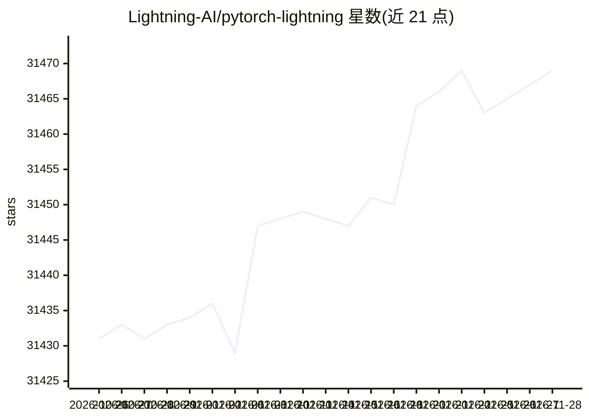

# Lightning-AI/pytorch-lightning

⭐ 31,469 · Python · Apache-2.0 · 推送 2026-11-27 · [GitHub](https://github.com/Lightning-AI/pytorch-lightning) · [官网](https://lightning.ai/pytorch-lightning/?utm_source=ptl_readme&utm_medium=referral&utm_campaign=ptl_readme) · 组织维护

**让开发者以少量样板代码在多 GPU/TPU 上训练与微调模型的 PyTorch 框架**

PyTorch Lightning 是组织 PyTorch 训练代码的框架，将反向传播、混合精度、多 GPU 与分布式训练等工程代码自动化，用户保留模型逻辑控制权。包含两个核心包：PyTorch Lightning（规模化训练与部署的 Trainer 抽象）与 Lightning Fabric（对训练循环和扩展策略提供专家级控制，可自建 Trainer）。支持 DDP/FSDP/DeepSpeed 策略、16-bit 精度、早停、检查点、TorchScript/ONNX 导出。同一代码可在 CPU、GPU、TPU、多节点运行；另提供 Lightning Cloud 托管服务，也可在自有硬件或云上运行。

## 筛选速览

| 维度 | 判定 | 备注 |
|---|---|---|
| AI 角色 | `ai-ecosystem` | LLM/agent 周边工具 |
| 许可风险 | `permissive` | Apache-2.0 |
| 部署形态 | `library` | 以包/库形式分发 |
| 模型依赖 | — | README 未给出锁定关系 |
| 硬件要求 | — | 无带数字的原话,不猜 |
| 安装摩擦 | `medium` | 含编译或系统依赖之一 |
| 成熟度 | — | 结构信号不足 |

## 动量与使用信号

- 维护:`active` — 距上次 push 5.9 天,年发版 6,431 位贡献者
- 涨星:近 1 天 **+2**(自 20261016 起算)
- 安装:pypi 包 `lightning` 月下载 3,753,872

## 能力要点

- 零代码改动从单机扩展到数千 GPU 或多节点训练
- 内置 DDP、FSDP、DeepSpeed 分布式策略与混合精度
- 支持早停、检查点、实验管理器与 TorchScript/ONNX 导出
- 提供 PyTorch 与 Lightning 代码转换示例

## 适用场景

- 在不改核心代码的前提下把单卡训练扩展到多 GPU 多节点
- 微调 LLM、diffusion、BERT 等各类模型做分类、分割、摘要等任务
- 用 Fabric 精细控制训练循环以扩展基础模型
- 将训练好的模型导出为 TorchScript/ONNX 用于生产部署

## 场景标签

`模型训练` `微调` · 领域:训练与推理

## 证据(README 行号)

> L33: Training models in plain PyTorch requires writing and maintaining a lot of repetitive engineering code. Handling ba
> L44: PyTorch Lightning: Train and deploy PyTorch at scale.
> L46: Lightning Fabric: Expert control.

## 星数曲线

2026-10-26 31,431 → 2026-11-28 31,469（+38）

---
*卡片 v1 · prompt 1.4 · 生成 2026-11-28 · 置信度 high · 依据 README sha `1d54e3ae1ae4` · [字段定义](../../DATASET.md)*
