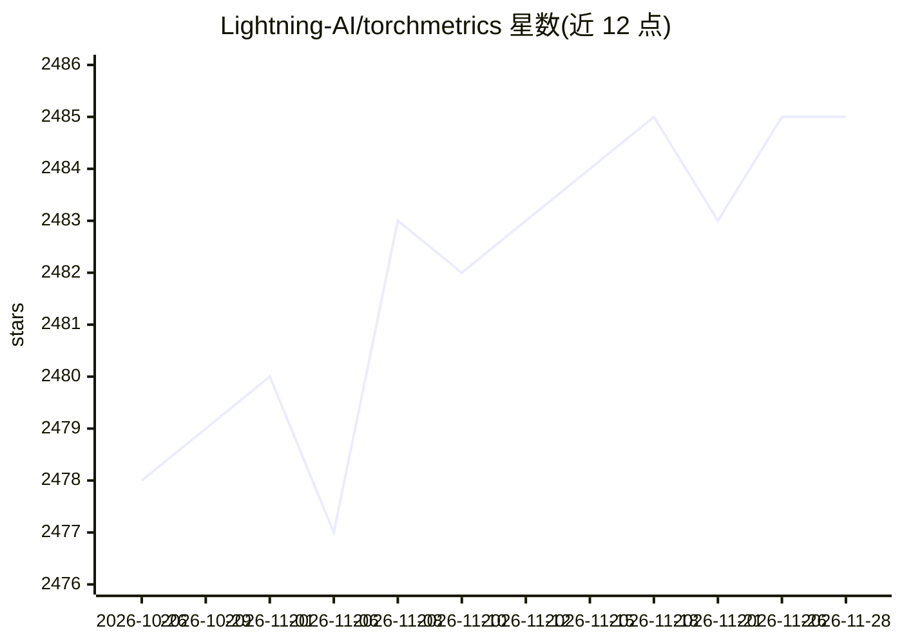

# Lightning-AI/torchmetrics

⭐ 2,485 · Python · Apache-2.0 · 推送 2026-11-27 · [GitHub](https://github.com/Lightning-AI/torchmetrics) · [官网](https://lightning.ai/docs/torchmetrics/) · 组织维护

**为 PyTorch 开发者提供 100+ 机器学习指标实现与自定义 API**

TorchMetrics 是面向 PyTorch 应用的机器学习指标库，提供 100+ 覆盖音频、分类、检测、检索、图像、回归、分割、文本等领域的指标实现，以及自定义指标的易用 API。模块化指标内置状态，自动完成跨批次累积与多设备间同步，可在 CPU、单 GPU、多 GPU/多节点（DDP）下运行，另提供函数式接口与内置绘图（.plot）支持。通过 PyPI、conda、uv 或源码安装，部分领域指标需额外 extras 依赖。

## 筛选速览

| 维度 | 判定 | 备注 |
|---|---|---|
| AI 角色 | `ai-native` | 本体是模型或模型工具 |
| 许可风险 | `permissive` | Apache-2.0 |
| 部署形态 | `library` | 以包/库形式分发 |
| 模型依赖 | — | README 未给出锁定关系 |
| 硬件要求 | — | 无带数字的原话,不猜 |
| 安装摩擦 | `low` | 无编译、无系统依赖或容器化 |
| 成熟度 | — | 结构信号不足 |

## 能力要点

- 100+ 指标实现，覆盖 10 个领域（音频/分类/检测/图像/文本等）
- 模块化指标自动累积批次并在多设备间同步
- 可配合 PyTorch Lightning 使用，指标自动放到正确设备并支持日志记录
- 子类化 torchmetrics.Metric 实现 update/compute 即可自定义指标

## 适用场景

- PyTorch 训练循环中标准化计算评估指标
- 分布式训练（DDP/多 GPU）下自动同步指标
- 为研究项目快速实现自定义评估指标
- 用 .plot 方法可视化指标结果

## 场景标签

`模型评测` · 领域:评测与运维

## 证据(README 行号)

> L89: TorchMetrics is a collection of 100+ PyTorch metrics implementations and an easy-to-use API to create custom metric
> L163: - Audio

## 星数曲线

2026-10-26 2,478 → 2026-11-28 2,485（+7）

---
*卡片 v1 · prompt 1.4 · 生成 2026-11-28 · 置信度 high · 依据 README sha `1a26e2375bae` · [字段定义](../../DATASET.md)*
