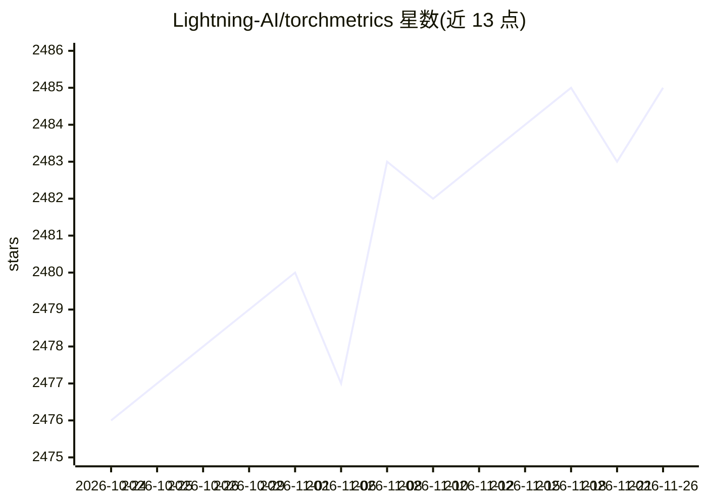

# Lightning-AI/torchmetrics

⭐ 2,485 · Python · Apache-2.0 · 推送 2026-11-25 · [GitHub](https://github.com/Lightning-AI/torchmetrics) · [官网](https://lightning.ai/docs/torchmetrics/) · 组织维护

**为 PyTorch 开发者提供分布式可扩展的机器学习指标库**

TorchMetrics 是一个包含 100+ PyTorch 指标实现的 Python 库，并提供自定义指标的易用 API。核心机制包括：模块化指标内部维护状态以自动跨批次累积、多设备间自动同步、支持 CPU/单 GPU/多 GPU/DDP 分布式训练场景；同时提供函数式接口（输入输出均为 torch.tensor）。覆盖音频、分类、检测、图像、回归、分割、文本等 10 个领域，内置绘图功能，部分领域需安装额外依赖。通过 pip/conda/uv/源码安装，Apache 2.0 许可。

## 筛选速览

| 维度 | 判定 | 备注 |
|---|---|---|
| AI 角色 | `ai-native` | 本体是模型或模型工具 |
| 许可风险 | `permissive` | Apache-2.0 |
| 部署形态 | `library` | 以包/库形式分发 |
| 模型依赖 | — | README 未给出锁定关系 |
| 硬件要求 | — | 无带数字的原话,不猜 |
| 安装摩擦 | `low` | 无编译、无系统依赖或容器化 |
| 成熟度 | — | 结构信号不足 |

## 能力要点

- 100+ 指标实现，覆盖 10 个领域（分类/检测/分割/文本等）
- 模块化指标自动跨批次累积与多设备同步
- 适配分布式训练（单 GPU/多 GPU/多节点 DDP）
- 通过子类化 torchmetrics.Metric 实现 update/compute 创建自定义指标，并内置绘图支持

## 适用场景

- 为 PyTorch 训练流程接入标准化评估指标
- 多 GPU/多节点分布式训练下的指标计算与同步
- 为研究领域（音频/图像/文本等）快速调用对应指标并可视化结果
- 以子类化方式封装自定义评估指标

## 场景标签

`模型评测` · 领域:评测与运维

## 证据(README 行号)

> L1: **Machine learning metrics for distributed, scalable PyTorch applications.**
> L89: TorchMetrics is a collection of 100+ PyTorch metrics implementations and an easy-to-use API to create custom metric
> L160: In total TorchMetrics contains 100+ metrics, which

## 星数曲线

2026-10-24 2,476 → 2026-11-26 2,485（+9）

---
*卡片 v1 · prompt 1.4 · 生成 2026-11-24 · 置信度 high · 依据 README sha `68b612f6aec3` · [字段定义](../../DATASET.md)*
