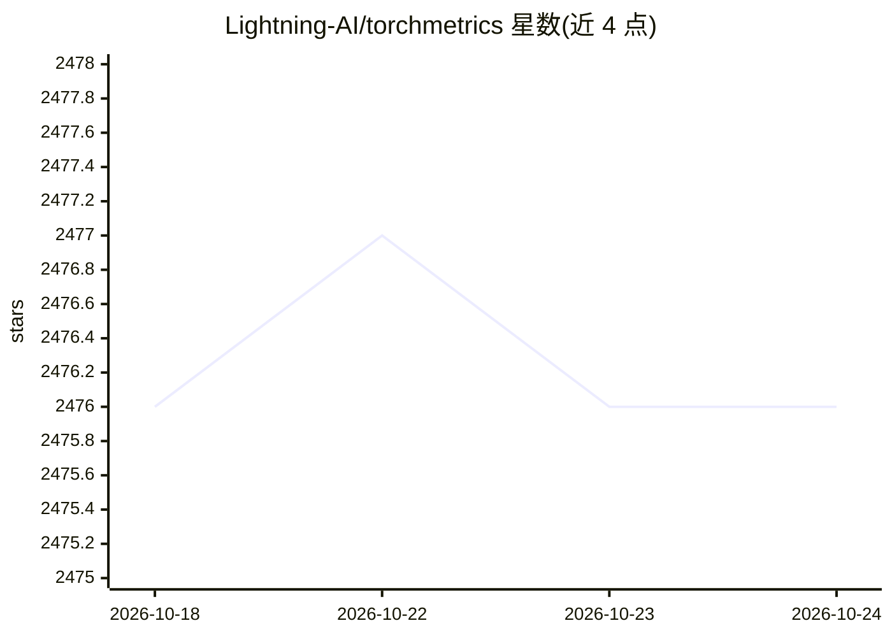

# Lightning-AI/torchmetrics

⭐ 2,476 · Python · Apache-2.0 · 推送 2026-10-07 · [GitHub](https://github.com/Lightning-AI/torchmetrics) · [官网](https://lightning.ai/docs/torchmetrics/) · 组织维护

**面向 PyTorch 的 100+ 机器学习指标库，支持分布式训练**

Lightning-AI 维护的 PyTorch 指标集合：内置 100+ 指标，覆盖音频、分类、检测、图像、多模态、回归、分割、文本等领域；提供模块化与函数式两套 API，可子类化 Metric 自定义指标。机制上自动化跨批次累积与多设备同步，在 CPU、单 GPU、多 GPU/多节点下用法一致；与 PyTorch Lightning 集成时指标自动放置到正确设备并支持原生日志记录。内置 .plot 绘图方法（需额外依赖）。以 Python 包分发。

## 筛选速览

| 维度 | 判定 | 备注 |
|---|---|---|
| AI 角色 | `ai-ecosystem` | LLM/agent 周边工具 |
| 许可风险 | `permissive` | Apache-2.0 |
| 部署形态 | `library` | 以包/库形式分发 |
| 模型依赖 | — | README 未给出锁定关系 |
| 硬件要求 | — | 无带数字的原话,不猜 |
| 安装摩擦 | `low` | 无编译、无系统依赖或容器化 |
| 成熟度 | — | 结构信号不足 |

## 能力要点

- 100+ 内置指标，覆盖音频/分类/检测/图像/多模态/文本等领域
- 跨批次自动累积与多设备自动同步，支持分布式训练
- 模块化与函数式双 API，可子类化自定义指标
- 内置 .plot 指标可视化方法

## 适用场景

- PyTorch 训练流程中标准化计算与记录评估指标
- 多 GPU/多节点分布式训练下的指标同步
- 快速实现自定义评估指标并复用统一接口

## 场景标签

`模型评测` · 领域:评测与运维

## 证据(README 行号)

> L90: TorchMetrics is a collection of 100+ PyTorch metrics implementations and an easy-to-use API to create custom metric
> L161: In total TorchMetrics contains 100+ metrics, which

## 星数曲线

2026-10-18 2,476 → 2026-10-24 2,476（+0）

---
*卡片 v1 · prompt 1.4 · 生成 2026-10-21 · 置信度 high · 依据 README sha `e4ae6afd02b5` · [字段定义](../../DATASET.md)*
