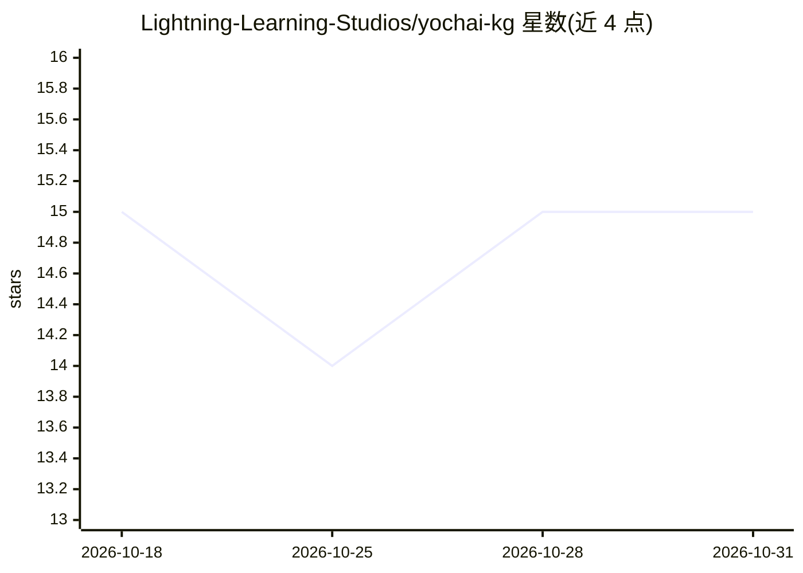

# Lightning-Learning-Studios/yochai-kg

⭐ 15 · Python · Apache-2.0 · 推送 2026-10-30 · [GitHub](https://github.com/Lightning-Learning-Studios/yochai-kg) · [官网](https://yochai.lightningstudios.ai/open-kg) · 组织维护

**犹太文本传统知识图谱的只读 MCP 网关，供 AI agent 查询**

由 Lightning Learning Studios 维护的 Yochai 知识图谱开放网关：以 MCP（Streamable-HTTP/stdio）只读方式向 AI agent 与开发者开放 1,037 部犹太经典文本、37.3 万条双语（希伯来语+英语）语义分段段落、257 万实体、17,635 个规范化概念及先修学习 DAG。提供 18 个只读工具与 run_cypher 原始 Cypher 通道，写操作被拒、不暴露数据库凭证。使用需申请免费 API key；支持本地自建实例，附 SKILL.md 技能配方（dvar torah、source sheet 等）。

## 筛选速览

| 维度 | 判定 | 备注 |
|---|---|---|
| AI 角色 | `ai-knowledge` | 知识聚合/清单类 |
| 许可风险 | `permissive` | Apache-2.0 |
| 部署形态 | `library` | 以包/库形式分发 |
| 模型依赖 | — | README 未给出锁定关系 |
| 硬件要求 | — | 无带数字的原话,不猜 |
| 安装摩擦 | `low` | 无编译、无系统依赖或容器化 |
| 成熟度 | — | 结构信号不足 |

## 能力要点

- 1,037 部经典、37.3 万双语语义段落、257 万实体、17,635 规范概念构成的知识图谱
- MCP 只读网关：18 个策展工具 + run_cypher 原始 Cypher 遍历
- 全部结果带引用与回源深链，写操作按构造被拒绝
- SKILL.md 技能配方（dvar-torah/source-sheet/cite/outline/research）

## 适用场景

- 让 Claude 等 MCP 客户端的 agent 检索并溯源犹太经典文本
- 教师与学者构建跨时代的双语 source sheet 与先修学习序列
- 研究者把图谱当作数据集查询（概念网络、实体层、主题聚类）
- 开发者在其上构建学习应用与研究助手

## 场景标签

`知识图谱` `科研工具` · 领域:知识与检索

## 证据(README 行号)

> L3: **A read-only doorway into a knowledge graph of the Jewish textual tradition — open to any AI agent.**
> L19: - **1,037 texts** — Tanakh, Talmud (Bavli & Yerushalmi), Midrash, Halakha, Kabbalah, Hasidut, Jewish philosophy, re
> L28: All of it is reachable in two ways: **curated tools** for the common paths, and **`run_cypher`** — a raw, read-only

## 星数曲线

2026-10-18 15 → 2026-10-31 15（+0）

---
*卡片 v1 · prompt 1.4 · 生成 2026-10-30 · 置信度 high · 依据 README sha `b2ef06e94b2c` · [字段定义](../../DATASET.md)*
