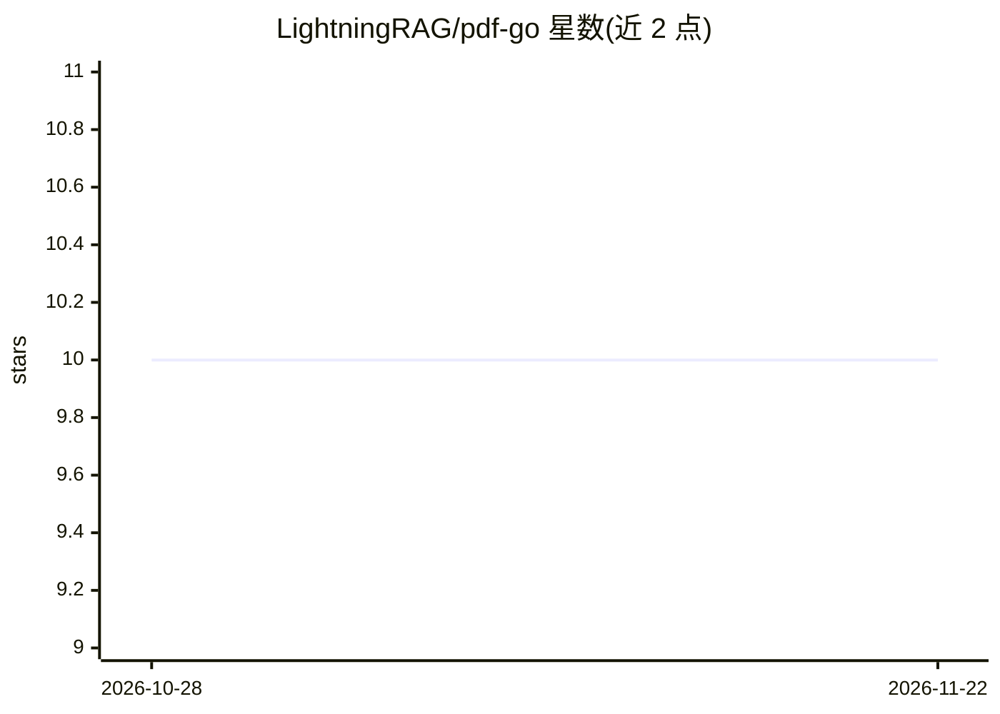

# LightningRAG/pdf-go

⭐ 10 · Go · MIT · 推送 2026-04-17 · [GitHub](https://github.com/LightningRAG/pdf-go) · [官网](https://LightningRAG.com) · 组织维护

**纯 Go PDF 读写库：解析、文本提取与合并**

以 Go 库形式提供的 PDF 读写工具，导入路径 github.com/lightningrag/pdf-go/pdf，要求 Go 1.20+，运行时仅依赖标准库。提供文件打开与解析（xref/trailer/catalog、多种流过滤器）、页面列表与页面盒/旋转/注释读取、两级文本提取（启发式 ExtractText 与支持 ToUnicode/CMap/Form XObject 的 Advanced 版本）、文档元数据与大纲读取，以及 PdfWriter 的增删页、合并、附件与表单辅助。限制：不做内容解密（无密码解密）、不解码图像到像素、不支持增量更新/签名。

## 筛选速览

| 维度 | 判定 | 备注 |
|---|---|---|
| AI 角色 | `ai-enhanced` | 去掉 AI 部分产品仍成立 |
| 许可风险 | `permissive` | MIT |
| 部署形态 | `None` |  |
| 模型依赖 | — | README 未给出锁定关系 |
| 硬件要求 | — | 无带数字的原话,不猜 |
| 安装摩擦 | `low` | 无编译、无系统依赖或容器化 |
| 成熟度 | — | 结构信号不足 |

## 能力要点

- 纯 Go 实现，运行时零第三方依赖（stdlib-only）
- 面向 ISO 32000 的 API，覆盖解析/页面/写入/合并流程
- 两级文本提取：轻量启发式与 Advanced（ToUnicode/CMap/Form XObject）
- 仓库自带 CLI 演示与多个可运行示例程序

## 适用场景

- 在 Go 服务中读取 PDF 文本用于后续处理
- 合并、拆分或增删 PDF 页面
- 读取 PDF 元数据、大纲与页面标签
- 检查文档是否加密并做结构性检查

## 场景标签

`文档解析` · 领域:知识与检索

## 证据(README 行号)

> L5: **pdf-go** is a **pure Go** library for **reading and writing PDF** documents. Import path: **`github.com/lightningr
> L8: - **Standard library only** at runtime (no third-party runtime dependencies)
> L9: - **ISO 32000–oriented** APIs for common document, page, stream, and writer workflows

## 星数曲线

2026-10-28 10 → 2026-11-22 10（+0）

---
*卡片 v1 · prompt 1.4 · 生成 2026-11-20 · 置信度 high · 依据 README sha `61d58bef5e61` · [字段定义](../../DATASET.md)*
