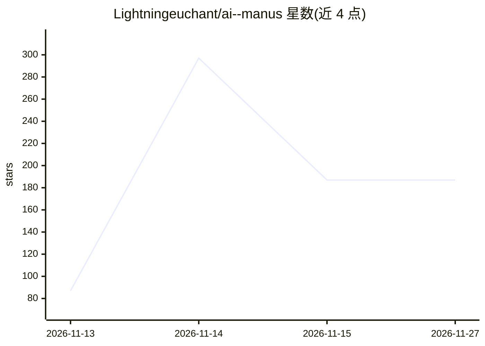

# Lightningeuchant/ai--manus

⭐ 187 · Apache-2.0 · 推送 2026-11-15 · [GitHub](https://github.com/Lightningeuchant/ai--manus) · 个人维护

**面向个人用户的自主 AI Agent：代用户执行代码与浏览器操作**

Manus 定位为自主 AI 代理，核心能力是在用户授权下编写并执行脚本、控制浏览器完成表单填写、信息收集等多步骤任务，适合学习、家庭项目和轻量办公场景，非面向企业平台。README 说明了会话间的任务模式记忆、代码与浏览器动作可在同一流程中衔接，并列出系统兼容性要求（双核 CPU、4 GB RAM 起，推荐 8 GB）。未提供具体的安装命令、技术架构或模型接入方式的说明，仅给出使用步骤与适用场景描述。

## 筛选速览

| 维度 | 判定 | 备注 |
|---|---|---|
| AI 角色 | `ai-native` | 本体是模型或模型工具 |
| 许可风险 | `permissive` | Apache-2.0 |
| 部署形态 | `None` |  |
| 模型依赖 | — | README 未给出锁定关系 |
| 硬件要求 | — | 无带数字的原话,不猜 |
| 安装摩擦 | `low` | 无编译、无系统依赖或容器化 |
| 成熟度 | — | 结构信号不足 |

## 能力要点

- 自主编写并执行代码完成任务
- 浏览器控制：导航网页、填写表单、收集信息
- 多步骤任务可在少监督下运行
- 代码执行与浏览器动作可在同一流程中衔接

## 适用场景

- 让学生整理研究笔记、跑小段脚本
- 代替人工在多个网页间收集信息、填表
- 把重复性小任务交给后台代理处理

## 场景标签

`编码 Agent` `浏览器自动化` · 领域:效率与自动化

## 证据(README 行号)

> L10: - **Autonomous Code Execution:** Manus AI agent runs code on its own to complete tasks, so you can focus on decisio
> L18: Manus is an autonomous AI agent designed to run code and control a browser on your behalf. Instead of acting like a

## 星数曲线

2026-11-13 87 → 2026-11-27 187（+100）

---
*卡片 v1 · prompt 1.4 · 生成 2026-11-17 · 置信度 mid · 依据 README sha `fbfd5e977bf4` · [字段定义](../../DATASET.md)*
